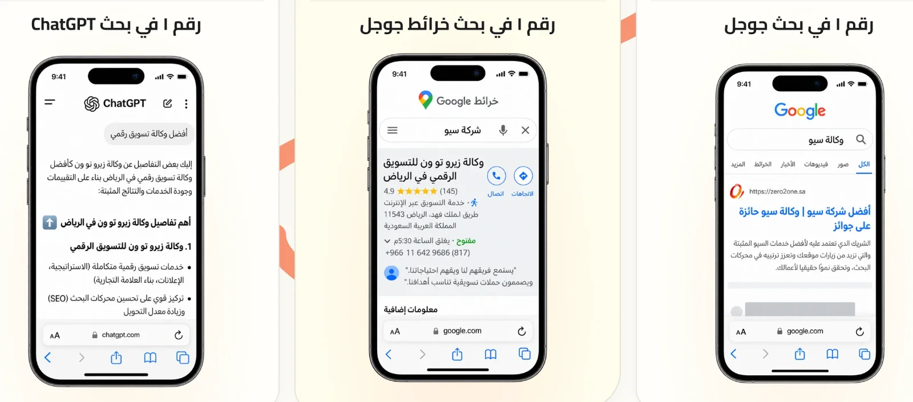
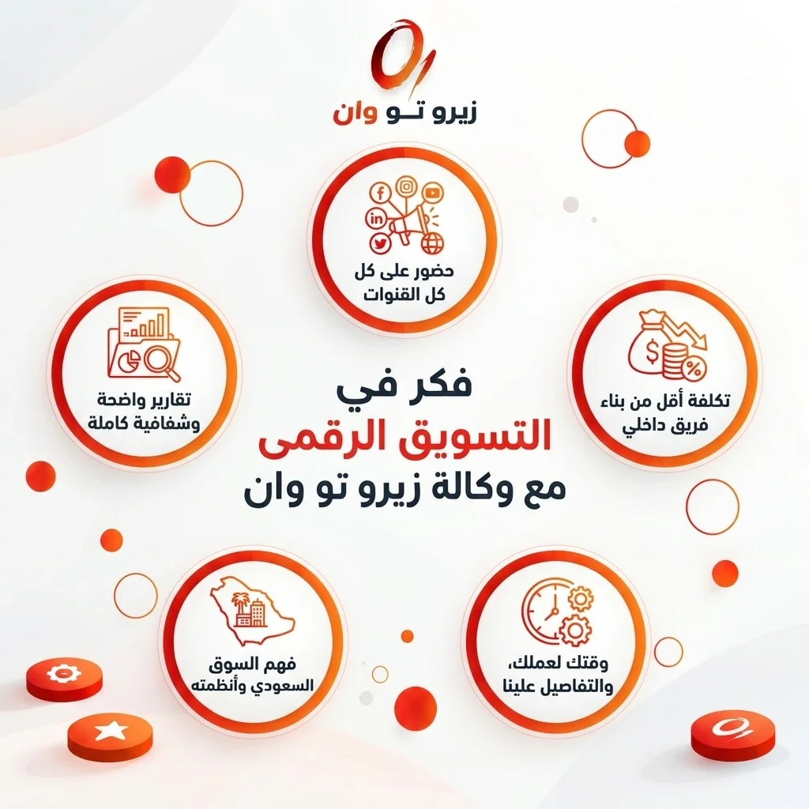

**«كنا مجرد اسم بلا شخصية، بنوا هويتنا كاملة وأعطوا علامتنا صوتًا واحدًا متسقًا، أخيرًا صار الناس يعرفوننا».** 

- **أحد عملاء زيرو تو وان**

هذه الجملة تختصر مشكلة يعيشها كثير من أصحاب المشاريع في الرياض: منتج ممتاز، وخدمة ما عليها كلام، لكن العميل ما يعرفك. وفي سوق سريع مثل السوق السعودي، أغلب المستهلكين يبدؤون رحلة الشراء من جوجل أو سناب شات أو تيك توك. فإذا ما كان لك حضور رقمي واضح، المنافس هو اللي بيوصل لعميلك قبلك.

بتعرف وش يعني التسويق الإلكتروني فعليًا، وكيف تميز أفضل [شركة تسويق إلكتروني في السعودية زيرو تو وان](https://zero2one.sa/ar/) من غيرها، وليش يعتمد أصحاب الأعمال على زيرو تو وان (ZERO 2 ONE) كشريك نمو من الرياض. الهدف إنك تنقل علامتك التجارية من الصفر (Zero) إلى القمة (One).

## ما هو التسويق الإلكتروني؟ ولماذا لم يعد خيارًا للشركات؟

التسويق الإلكتروني (أو التسويق الرقمي) هو ترويج المنتجات والخدمات والعلامات التجارية عبر القنوات المتصلة بالإنترنت. يشمل محركات البحث، ومنصات التواصل الاجتماعي، والمواقع والمتاجر الإلكترونية، والبريد الإلكتروني، وتطبيقات الجوال. الهدف إنك توصل للجمهور المستهدف بدقة، وتتفاعل معه، وتحوله إلى عميل، وتقيس كل خطوة بالأرقام.

### اللي يفرقه عن الإعلان التقليدي ثلاثة أشياء

- **الاستهداف الدقيق**: تقدر توصل لفئة عمرية محددة، أو لسكان حي معين في الرياض، أو لأشخاص بحثوا عن منتجك قبل ساعة.
- **القياس اللحظي**: كل نقرة وزيارة وعملية شراء لها رقم، فتعرف العائد على الاستثمار (ROI) بدل ما تخمّن.
- **المرونة**: الحملة اللي ما تجيب نتيجة توقفها أو تعدلها اليوم، ما تنتظر نهاية الشهر.

### التسويق الرقمي في السعودية: سوق يكبر بسرعة

المملكة من أعلى دول العالم في انتشار الإنترنت والهواتف الذكية. ومع مستهدفات رؤية السعودية 2030 في التحول الرقمي ونمو التجارة الإلكترونية عبر منصات مثل سلة وزد، صار المستهلك السعودي يقارن ويقرأ التقييمات ويشتري من جواله. وانتشرت معها وسائل الدفع الرقمية مثل مدى وApple Pay وخدمات "اشترِ الآن وادفع لاحقًا" مثل تابي وتمارا.

والرياض تحديدًا صارت مركز ثقل للأعمال في المنطقة. فيها مقرات إقليمية لشركات عالمية، ومنظومة شركات ناشئة نشطة، ومواسم تسويقية ضخمة مثل موسم الرياض. هذا يعني فرصًا أكبر ومنافسة أشد بنفس الوقت.

## التسويق الرقمي مقابل التسويق التقليدي

| **المعيار** | **التسويق التقليدي** | **التسويق الرقمي** |
| **القنوات** | التلفزيون، الإذاعة، الصحف، اللوحات الطرقية | جوجل، السوشيال ميديا، المواقع، البريد، التطبيقات |
| **الاستهداف** | عام لجمهور واسع | دقيق حسب العمر والموقع والاهتمام والسلوك |
| **القياس** | تقديري وصعب | لحظي ومفصل (CTR، CPA، ROAS) |
| **التعديل** | بطيء ومكلف | فوري وبأي وقت |
| **الميزانية** | مرتفعة غالبًا للبدء | مرنة وتبدأ بمبالغ أصغر |
| **الهدف الأقوى** | الوعي العام بالعلامة | الوعي + المبيعات المباشرة + الولاء من العملاء |

يعتمد التسويق التقليدي على التلفزيون والإذاعة والصحف واللوحات الطرقية. يوصل رسالة عامة لجمهور واسع، لكن قياس أثره تقديري وصعب، وتعديله بطيء ومكلف، وميزانية البدء فيه مرتفعة غالبًا. لذلك يخدم الوعي العام بالعلامة أكثر من المبيعات المباشرة.

أما التسويق الرقمي فيعتمد على جوجل والسوشيال ميديا والمواقع والبريد والتطبيقات. يستهدف الجمهور حسب العمر والموقع والاهتمام والسلوك، ويقيس النتائج لحظيًا بمؤشرات مثل نسبة النقر (CTR) وتكلفة اكتساب العميل (CPA) والعائد على الإنفاق الإعلاني (ROAS). وتقدر تبدأ فيه بميزانية أصغر وتعدّل حملاتك بأي وقت، لتحقق الوعي والمبيعات المباشرة والولاء معًا.

هذا ما يعني إن الإعلان التقليدي انتهى. لوحة على طريق الملك فهد ممكن تخدم الوعي بالعلامة. لكن نمو المبيعات القابل للقياس صار يعتمد بشكل أساسي على القنوات الرقمية.

## زيرو تو وان: شريكك الاستراتيجي للنمو الرقمي من الرياض

زيرو تو وان (ZERO 2 ONE) وكالة تسويق رقمي متكاملة مقرها الرياض. فكرتها بسيطة: التسويق الفعال ما يتحقق بخدمات منفصلة كل وحدة تشتغل لحالها. يتحقق لما تربطها كلها في منظومة واحدة: الهوية البصرية، وتصميم الموقع، وتحسين محركات البحث، والإعلانات المدفوعة، والمحتوى.

ولما تبحث على أفضل شركة تسويق إلكتروني في السعودية، المعيار الحقيقي مو عدد الخدمات المكتوبة في الموقع. المعيار هو قدرة الشركة على ثلاثة أشياء:

1. توحيد الخدمات ضمن استراتيجية واحدة مدروسة.
2. قياس الأثر بشفافية وتقارير واضحة.
3. فهم السوق السعودي: لهجة الجمهور وثقافته ومواسمه وطريقة شرائه.

**وهذي فلسفتنا**: نأخذ علامتك التجارية من حضور غير واضح إلى منظومة رقمية يعرف الجمهور من خلالها من أنت؟ وماذا تقدم؟ ولماذا يختارك؟

## خدمات زيرو تو وان للتسويق الإلكتروني

كل خدمة من هذه الخدمات لها صفحتها التفصيلية. هنا بنعطيك فكرة سريعة عن كل وحدة: وش هي، وليش تفرق، ومتى تحتاجها.

### 1. الاستشارات التسويقية

خطة تسويقية كاملة مبنية على دراسة السوق والمنافسين وتحليل الجمهور المستهدف، وتحدد القنوات والميزانية ومؤشرات الأداء (KPIs). 

أهميتها إنها توجه ميزانيتك قبل ما تصرفها، بدل التجارب العشوائية اللي تستنزف الريال بدون نتيجة. تحتاجها عند إطلاق مشروع جديد، أو دخول سوق جديد، أو لما تحس إن الصرف التسويقي ما يرجع بعائد واضح.

### 2. بناء وتطوير الهوية التجارية

هوية بصرية ولفظية متكاملة: الشعار، والألوان، والخطوط، ونبرة الصوت، ودليل استخدام العلامة. العميل يتذكر العلامة اللي تشبه نفسها في كل مكان، والهوية المتسقة تبني الثقة وترفع القيمة المدركة لمنتجك. تحتاجها إذا كان مشروعك في بدايته، أو إذا كانت علامتك تظهر بأشكال مختلفة في كل منصة.

### 3. تصميم وتطوير المواقع الإلكترونية

مواقع مخصصة بعيدة عن القوالب الجاهزة، سريعة ومتجاوبة مع الجوال، ومبنية على أسس تجربة المستخدم (UX) ومتوافقة مع متطلبات SEO من البداية. 

**موقعك هو فرعك الذي يفتح 24 ساعة**، والتصميم الجيد يحوّل الزيارة إلى طلب أو اتصال أو عملية شراء. تحتاجه إذا كان موقعك الحالي بطيئًا، أو قديمًا، أو ما يجيب طلبات رغم وجود زيارات.

### 4. تطوير المتاجر الإلكترونية والأنظمة المخصصة

متاجر إلكترونية آمنة وسريعة مربوطة بالدفع الإلكتروني وشركات الشحن، وأنظمة مخصصة للحجوزات وإدارة الطلبات والعمليات. 

تحول العمل اليدوي إلى نظام آلي، وتقلّل نسبة السلال المتروكة بتجربة شراء سلسة. تحتاجها عند بدء البيع أونلاين، أو لما يصير حجم الطلبات أكبر من قدرة الإدارة اليدوية.

### 5. تطوير تطبيقات الجوال

تطبيقات لنظامي iOS وأندرويد، مع النشر على App Store وGoogle Play. التطبيق يخليك على شاشة عميلك دائمًا، ويفتح لك الإشعارات وبرامج الولاء والطلب المتكرر. تحتاجه إذا كان عندك عملاء يتعاملون معك بشكل متكرر، مثل المطاعم والتجزئة والخدمات والحجوزات.

### 6. تحسين محركات البحث (SEO)

[خدمة تحسين محركات البحث](https://zero2one.sa/ar/services/seo-riyadh/) هو تحسين ظهور موقعك في نتائج البحث الأولى على جوجل. يشمل الـ SEO التقني، وتحسين المحتوى والكلمات المفتاحية، والروابط، والسيو المحلي عبر ملف النشاط التجاري على جوجل (Google Business Profile). يجيب لك زيارات مستمرة من ناس يدورون على خدمتك فعلًا، بدون ما تدفع على كل نقرة، وهو استثمار يتراكم مع الوقت. 

تحتاجه إذا كنت تبي نموًا مستدامًا على المدى المتوسط والطويل (النتائج تظهر غالبًا خلال 3 إلى 6 أشهر)، أو إذا كان منافسوك يتصدرون عمليات بحث المفروض إنها لك. تعرّف أكثر على خدمة تحسين محركات البحث في الرياض.

**تعرف أكثر على**: [نتائج مشاريع تحسين محركات البحث لشركتنا](https://zero2one.sa/ar/work/)

### 7. إدارة إعلانات جوجل (Google Ads)

[إدارة إعلانات جوجل (Google Ads)](https://zero2one.sa/ar/services/manage-google-adwords-campaigns/) او حملات الدفع مقابل النقرة (PPC) على شبكة البحث، وشبكة العرض (Display)، ويوتيوب، وحملات إعادة الاستهداف (Retargeting). تحطك أمام العميل في لحظة البحث نفسها، أي في أعلى نقطة نيّة شراء، وتبدأ نتائجها خلال أيام إلى أسابيع.

 تحتاجها لما تبي نتائج سريعة، أو لإطلاق منتج، أو لدعم المواسم مثل رمضان، واليوم الوطني السعودي، ويوم التأسيس، والجمعة البيضاء.

**تعرف أكثر على**: [نتائج مشاريع إدارة إعلانات جوجل](https://zero2one.sa/ar/work/)

### 8. إدارة الحملات الإعلانية على السوشيال ميديا

[إدارة حملات السوشيال ميديا](https://zero2one.sa/ar/services/digital-advertising/)، حملات مدفوعة على المنصات اللي يقضي فيها جمهورك وقته: سناب شات، تيك توك، إنستقرام، إكس، ولينكدإن للشركات (B2B). 

هذه المنصات تتيح استهدافًا دقيقًا حسب الاهتمامات والسلوك، وهي من أكثر القنوات تأثيرًا على قرار الشراء عند الجمهور السعودي. تحتاجها لبناء الوعي بالعلامة، أو لإطلاق عروض، أو لزيادة المبيعات المباشرة للمتاجر الإلكترونية.

### 9. إدارة حسابات التواصل الاجتماعي وصناعة المحتوى

تخطيط المحتوى وإنتاجه وجدولته لكل منصة حسب طبيعتها، مع التصاميم والفيديو القصير وإدارة التفاعل. المحتوى الجيد يحول الحسابات من مجرد واجهة إلى قناة نمو تجيب عملاء، مو متابعين بس. تحتاجها إذا كانت حساباتك متوقفة أو غير منتظمة، أو إذا كان التفاعل عاليًا والمبيعات ضعيفة.

## من أين تبدأ في التسويق الالكتروني لعملك؟

إذا كان مشروعك جديدًا بلا هوية، ابدأ بالهوية التجارية والخطة التسويقية. وإذا كنت تبي مبيعات سريعة، فإعلانات جوجل والسوشيال ميديا هي أقصر طريق. 

أما إذا كان هدفك زيارات مستدامة بتكلفة أقل على المدى الطويل، فالـ SEO هو الاستثمار الأذكى. وللبيع أونلاين تبدأ بالمتجر الإلكتروني مع حملات مدفوعة، ولبناء علاقة متكررة مع العميل يأتي دور التطبيق والمحتوى.

### جدول سريع: أي خدمة تبدأ فيها؟

| **هدفك الحالي** | **الخدمة الأنسب للبداية** | **متى تظهر النتائج عادة** |
| **مشروع جديد بلا هوية** | الهوية التجارية + الخطة التسويقية | من أول أسابيع التنفيذ |
| **مبيعات سريعة** | إعلانات جوجل + إعلانات السوشيال | خلال أيام إلى أسابيع |
| **زيارات مستدامة بتكلفة أقل** | تحسين محركات البحث (SEO) | غالبًا 3 إلى 6 أشهر |
| **البيع أونلاين** | المتجر الإلكتروني + الحملات المدفوعة | حسب سرعة الإطلاق والميزانية |
| **علاقة متكررة مع العميل** | تطبيق الجوال + المحتوى | على المدى المتوسط |

## لماذا تختار زيرو تو وان كشريك تسويقي؟

### 1. حضور على كل القنوات بمنظومة واحدة

من السوشيال ميديا وصناعة المحتوى إلى حملات محركات البحث (SEO وSEM)، كل القنوات تشتغل برسالة واحدة وهوية واحدة. هذا يمنع تشتت الميزانية، ويكشف لك فرصًا جديدة قبل منافسيك.

### 2. تكلفة أقل من بناء فريق داخلي

| **المقارنة** | **فريق داخلي** | **وكالة مثل زيرو تو وان** |
| **التكلفة** | رواتب وتأمينات وتدريب وأدوات | باقة شهرية حسب نطاق العمل |
| **تنوع الخبرات** | محدود بعدد الموظفين | فريق متعدد التخصصات |
| **الأدوات** | اشتراكات منفصلة مكلفة | أدوات تحليل وتتبع ومراقبة منافسين متاحة ضمن الخدمة |
| **سرعة البدء** | أشهر للتوظيف والتأهيل | خلال أسابيع |

بناء فريق تسويق داخلي متكامل يحتاج استراتيجي، ومصمم، وكاتب محتوى، ومختص إعلانات، ومختص SEO، ومحلل بيانات. هذا يعني رواتب وتأمينات وتدريب، واشتراكات أدوات مكلفة، وأشهر من التوظيف قبل ما يبدأ الشغل فعليًا.

مع زيرو تو وان تحصل على فريق متعدد التخصصات بباقة شهرية حسب نطاق العمل، مع أدوات التحليل والتتبع ومراقبة المنافسين ضمن الخدمة، وبدء خلال أسابيع. ونشتغل على خفض تكلفة اكتساب العميل (CPA) ورفع العائد على الإنفاق الإعلاني (ROAS)، عشان كل ريال تصرفه يرجع بأفضل عائد ممكن.

### 3. وقتك لعملك، والتفاصيل علينا

نتولى المتابعة اليومية لحملات PPC، وتعديل عروض الأسعار، واستبعاد الكلمات غير ذات الصلة، وإنتاج التصاميم والمواد الإعلانية بسرعة، مع قوالب جاهزة لاستخدامك لاحقًا. وأنت تتفرغ لتطوير منتجك وخدمتك.

### 4. أفكار جديدة مبنية على البيانات

نحدد مؤشرات الأداء (KPIs) من البداية ونتابعها، ونحلل سلوك المستخدمين لتطوير موقعك. ونجمع خبرتنا الرقمية مع معرفتك المباشرة بمجالك، فتطلع أفكار محتوى ترفع التفاعل والتحويلات.

### 5. فهم السوق السعودي وأنظمته

نعرف مواسم الشراء، ولغة الجمهور السعودي، والفروق بين ما ينجح في الرياض وما ينجح في جدة أو الدمام. ونراعي الأنظمة المحلية، مثل نظام حماية البيانات الشخصية، ومتطلبات رخصة موثوق عند التعاون مع المؤثرين.

### 6. تقارير واضحة وشفافية كاملة

**تقارير أداء دورية تقيس النتائج الفعلي**ة: الزيارات، والعملاء المحتملين، والمبيعات، والعائد على الاستثمار. التقرير لازم يجاوب على سؤال واحد: هل فلوسك تشتغل؟

**مع Zero 2 One توقف عن التجارب العشوائية، وابدأ رحلة نمو مدروسة لعملك.** [**تواصل معنا اليوم**](https://zero2one.sa/ar/contact/)**!**

## كيف تختار أفضل شركة تسويق إلكتروني في الرياض؟ (4 خطوات عملية)

سواء اخترتنا أو اخترت شركة ثانية، هذه الخطوات بتحميك من شراكة غلط تكلفك وقتًا وميزانية.

### الخطوة 1: حدد احتياجك ونطاق العمل (Scope of Work)

**قبل ما تكلم أي وكالة، جاوب على هذه الأسئلة:**

1. **وش تحتاج فعلًا؟ هوية؟ مبيعات سريعة؟ تصدر نتائج جوجل؟**
2. **وش شكل النجاح؟** مثلًا: مضاعفة العملاء المحتملين من البحث العضوي، أو بيع عدد معيّن من الوحدات بعائد إعلاني محدد.
3. **كم ميزانيتك؟** الميزانية الواقعية تساعد الوكالة تقدّم عرضًا يناسبك بدل ما تبيعك خدمات ما تحتاجها.
4. **من جمهورك؟** العمر، والمنطقة، والاهتمامات، ودوافع الشراء.

ثم اكتب هذا كله في موجز مشروع (Brief) أو طلب تقديم عرض (RFP) فيه: خلفية النشاط، والأهداف، والميزانية، والجدول الزمني.

### الخطوة 2: كون قائمة مختصرة

1. **التوصيات**: اسأل شركاءك وزملاءك في السوق عن تجاربهم.
2. **البحث على جوجل**: ابحث بعبارة مثل "شركة تسويق إلكتروني في الرياض". والوكالة اللي تتصدر نتائج البحث لنفسها غالبًا تفهم في الـ SEO.
3. **معرض الأعمال (Portfolio)** **ودراسات** **الحالة**: لا تكتفِ بجمال التصاميم، واطلب النتائج اللي حققتها.
4. **التخصص والحجم**: هل حجم فريق الوكالة يناسب حجم مشروعك؟

### الخطوة 3: قيم الخبرة والمنهجية

**في أول اجتماع، لاحظ:**

- هل الوكالة واضحة وصادقة، أم تعطيك وعودًا كبيرة؟
- هل تسأل عن تحديات عملك قبل ما تعرض خدماتها؟
- هل عندها خبرة في قطاعك داخل السوق السعودي؟
- هل تقدم أفكارًا إبداعية مختلفة، أم حلولًا مكررة؟

### الخطوة 4: قرر وابدأ بذكاء

- اطلب تسعيرًا واضحًا واسأل عن أي رسوم خفية أو رسوم على تغيير نطاق العمل.
- إذا كنت مترددًا، ابدأ بمشروع تجريبي قبل الالتزام الطويل.

**تذكر القاعدة المعروفة**: الجودة، والسرعة، والتكلفة المنخفضة، وغالبًا تقدر تختار اثنين منها فقط. وضح أولويتك من البداية.

### أسئلة لازم تسألها لأي وكالة تسويق

1. كيف تقيسون النجاح؟ وما مؤشرات الأداء المناسبة لمشروعي؟
2. كل كم تصلني التقارير؟ وماذا تتضمن؟
3. هل الحسابات الإعلانية والملفات والتصاميم ملكي أنا؟
4. كيف تتعاملون مع تغيير نطاق العمل؟
5. ماذا تفعلون لما تسير الحملة بشكل غلط؟
6. هل عندكم أعمال سابقة في مجالي داخل السعودية؟

**خلي بالك**: في زيرو تو وان نلتزم بمنهجية واضحة وأهداف قابلة للقياس، لكن نضمن فهم اعمق لخوارزميات جوجل والذكاء الاصطناعي (Ai).

## متى يكون الوقت المناسب للتعاقد مع شركة تسويق؟

- عند إطلاق مشروع جديد وتحتاج انطلاقة قوية من البداية.
- إذا لاحظت انخفاضًا في المبيعات أو التفاعل وما تعرف السبب.
- لما تبي التوسع في مدن جديدة داخل المملكة أو في أسواق الخليج.
- إذا كان عندك فريق داخلي ويحتاج دعمًا متخصصًا في قنوات معينة مثل SEO أو الإعلانات.

### الخلاصة: ابدأ رحلتك من الصفر إلى الواحد

السوق السعودي ما يكافئ اللي عنده أفضل منتج فقط، يكافئ اللي يعرف يوصل منتجه للناس الصح بالطريقة الصح. وأفضل شركة تسويق إلكتروني هي اللي تشتغل كشريك يفهم مشروعك، ويربط كل القنوات في استراتيجية واحدة، ويقيس النتائج بشفافية. مو اللي تبيعك أكبر عدد خدمات.

في زيرو تو وان نجمع بين فهم سلوك جمهورك، والإبداع، والحلول التقنية، لنربط علامتك التجارية بمحتواك وبتجربة عملائك.

**إذا كنت جاهزًا تنقل علامتك للمستوى التالي، تواصل مع فريق زيرو تو وان واحجز استشارتك المجانية اليوم.**

## الأسئلة الشائعة

### ما هي شركة التسويق الإلكتروني؟

جهة متخصصة تساعد الأعمال على النمو عبر الإنترنت باستخدام تحسين محركات البحث (SEO)، والإعلانات المدفوعة، وإدارة السوشيال ميديا، وصناعة المحتوى، وتصميم المواقع والمتاجر، وتحليل البيانات.

### ما الذي يميز أفضل شركة تسويق إلكتروني في السعودية عن غيرها؟

**ثلاثة أشياء**: فهم السوق السعودي وسلوك المستهلك المحلي، وتكامل الخدمات ضمن استراتيجية واحدة، والشفافية في التقارير والتسعير. وأعمال سابقة داخل المملكة دليل عملي على ذلك.

### كم تكلفة خدمات التسويق الإلكتروني في الرياض؟

تختلف حسب نطاق العمل وعدد القنوات وحجم الميزانية الإعلانية. الأفضل إنك تحدد أهدافك وميزانيتك أولًا، ثم تطلب عرضًا مفصلًا يوضح ما يشمله السعر وما لا يشمله.

### متى تظهر نتائج التسويق الرقمي؟

الإعلانات المدفوعة تبدأ بإظهار نتائج خلال أيام إلى أسابيع. أما تحسين محركات البحث والتسويق بالمحتوى فيحتاجان غالبًا من 3 إلى 6 أشهر لنتائج ملموسة، حسب المنافسة وحالة الموقع.

### هل تقدم شركات التسويق الرقمي استراتيجيات مخصصة؟

**نعم**، تدرس الشركات الاحترافية أهداف عملك وجمهورك ومنافسيك لتقديم استراتيجيات تسويقية مخصصة بالكامل تضمن تحقيق أفضل النتائج ونمو نشاطك التجاري.

### عندي فريق تسويق داخلي، هل أحتاج وكالة؟

**في كثير من الحالات نعم**. الوكالة تكمل فريقك بخبرات متخصصة وأدوات تحليل متقدمة يصعب توفيرها داخليًا، خصوصًا في SEO وإدارة الحملات المدفوعة.

### هل تخدم زيرو تو وان الشركات الناشئة والمتوسطة؟

**نعم**. نصمم الخطة ونطاق العمل حسب مرحلة المشروع وميزانيته، سواء كنت تبدأ من الصفر أو تبي توسّع حضورًا موجودًا.

### هل تقدمون خدماتكم خارج الرياض؟

مقرنا في الرياض، والتسويق الرقمي بطبيعته ما يتقيد بالمكان، فنقدر نخدم المشاريع في مختلف مناطق المملكة ونستهدف جمهورها بدقة.
