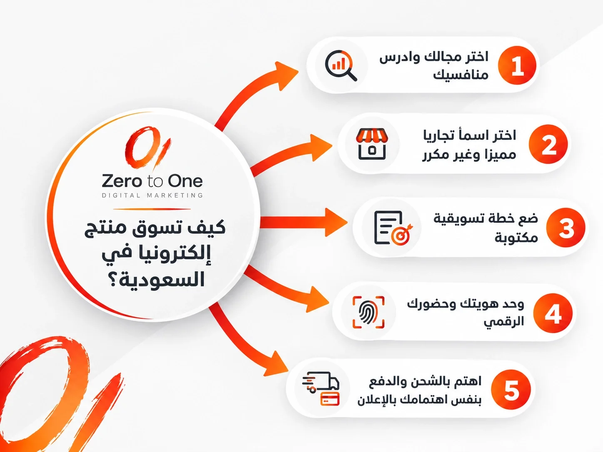

في البداية لا بد من إدراك نقطة مهمة بعد تساؤلك الأولي " كيف اسوق منتجاتي ؟" حول عدم اعتبار المسوقين في كفة المنتجين - أي المسوقين عبر وسائل التواصل الاجتماعي ومسوقي المحتوى- لن يكون لديهم الدراية الكاملة بمنتجك؛ مما يعوقهم عن تسويقه بشكل صحيح عبر القنوات التي يستخدمها العملاء. 

وبصفتك مسوق منتج، فإن وظيفتك ليست بالضرورة أن تتمحور حول تنفيذ حملات تسويقية أو كتابة المحتوى. بدلاً من ذلك، ستتمثل مهمتك في تمكين الفرق المتخصصة لتسويق منتجاتك بشكل فعال.

تابع مع خبراء [شركة تسويق إلكتروني في السعودية زيرو تو وان](https://zero2one.sa/ar/).

## تعريف التسويق وانواعه

التسويق ليس مجرد إعلان. هو كل نشاط يبدأ من فهم ما يحتاجه العميل، ويمر بتصميم المنتج وتسعيره وطريقة عرضه، وينتهي بوصوله إلى يد العميل ورضاه عنه. 

**وببساطة**: التسويق عملية تحدد رغبات العميل ثم تعمل على تلبيتها بطريقة مربحة.

أما تسويق المنتج فهو جزء أدق من هذه العملية، ويركز على منتج بعينه: لمن صنع؟ وما المشكلة التي يحلها؟ وبماذا يختلف عن البدائل؟ وكيف يقدم في كل قناة؟ 

وبينما يهتم التسويق العام بالعلامة التجارية ككل، ينشغل تسويق **المنتج بسؤال واحد**: كيف نبيع هذا المنتج تحديدًا لهذا العميل تحديدًا؟

### كيف أسوق منتجي بدون رأس مال كبير؟

ابدأ بالقنوات المجانية، محتوى أصلي على تيك توك وسناب شات، وتعاون مع علامات مكملة، وتسويق بالعمولة لا تدفع فيه إلا عند البيع. وبعد أن تتأكد من وجود طلب على المنتج، خصص ميزانية صغيرة للإعلانات واختبرها.

### عناصر المزيج التسويقي (4Ps) باختصار

أي خطة تسويق تقوم على أربعة عناصر مترابطة، وإذا ضعف واحد منها تأثرت الخطة كلها:

| **العنصر** | **السؤال الذي يجيب عنه** | **مثال من السوق السعودي** |
| **المنتج (Product)** | ماذا تبيع؟ وما المشكلة التي يحلها؟ | عباية عملية بقماش مناسب للصيف |
| **السعر (Price)** | كم يدفع العميل؟ وهل يرى أن السعر يستحق القيمة؟ | خيار التقسيط عبر تابي أو تمارا |
| **المكان (Place)** | أين يجد العميل منتجك وكيف يصله؟ | متجر على سلة مع شحن لكل مناطق المملكة |
| **الترويج (Promotion)** | كيف يعرف العميل بمنتجك ويقتنع به؟ | حملة سناب شات مع مشهورة محلية |

## أنواع التسويق: أيها يناسب منتجك؟

قبل أن تختار القناة، اعرف خريطة الخيارات المتاحة. وكل نوع من الأنواع التالية يستحق مقالًا مستقلًا، وسنكتفي هنا بنظرة سريعة تساعدك على الاختيار.

### 1. التسويق الرقمي (Digital Marketing)

التسويق الرقمي، أو كما يسميه كثيرون "الديجيتال ماركتنج"، هو الترويج للمنتجات عبر الإنترنت والقنوات الرقمية. ويتميز بأنك تقيس نتائجه بدقة: تعرف كم شخصًا شاهد إعلانك، وكم منهم ضغط عليه، وكم اشترى. وأبرز أنواع التسويق الرقمي:

- **تحسين محركات البحث (SEO)**: أن يظهر موقعك في نتائج جوجل الأولى عندما يبحث العميل عن منتج مثل منتجك. ويمتد اليوم ليشمل الظهور في إجابات أدوات الذكاء الاصطناعي مثل ChatGPT وGemini، لأن عملاء كثيرين صاروا يسألونها قبل الشراء.
- **التسويق عبر محركات البحث المدفوع (SEM / PPC)**: إعلانات جوجل التي تظهر فوق النتائج، وتدفع فيها مقابل كل نقرة.
- **التسويق عبر وسائل التواصل الاجتماعي**: المحتوى والإعلانات على سناب شات وتيك توك وإنستغرام وإكس، وهي المنصات الأقوى حضورًا في السعودية.
- **التسويق بالمحتوى**: مقالات وفيديوهات وأدلة تفيد العميل وتبني ثقته في علامتك قبل أن يفكر في الشراء.
- **التسويق عبر البريد الإلكتروني**: رسائل مخصصة لعملائك الحاليين، وهو من أعلى القنوات عائدًا للمتاجر التي تملك قاعدة عملاء.
- **التسويق عبر المؤثرين**: التعاون مع مشاهير أو صناع محتوى يثق فيهم جمهورك.
- **التسويق بالعمولة (Affiliate Marketing)**: تدفع عمولة لمسوّق أو موقع خارجي عن كل عملية بيع تتم من خلال رابط الإحالة الخاص به، فلا تدفع إلا مقابل نتيجة.

### 2. التسويق التقليدي (Traditional Marketing)

ويعتمد على القنوات غير المتصلة بالإنترنت: اللوحات الإعلانية على الطرق، والإعلانات التلفزيونية والإذاعية، والمطبوعات، والتسويق عبر الهاتف. 

ما زال فعالًا للوصول إلى شرائح واسعة أو كبيرة في السن، لكنه أغلى وأصعب في قياس النتائج. ويكون اختيارًا منطقيًا للعلامات التي تملك ميزانية كبيرة، أو للمنتجات المرتبطة بمكان معين مثل المطاعم والمعارض.

### 3. التسويق الداخلي والخارجي (Inbound vs Outbound)

- **التسويق الداخلي (Inbound)**: تجذب العميل إليك بمحتوى يحل مشكلته، فيأتي هو باحثا عنك.
- **التسويق الخارجي (Outbound)**: تذهب أنت إلى العميل بإعلان أو رسالة لم يطلبها.

### 4. تسويق B2C وB2B

- **B2C**: تبيع للمستهلك الفرد مباشرة، والقرار غالبا سريع وعاطفي.
- **B2B**: تبيع لشركات أخرى، والقرار أبطأ ويمر على أكثر من شخص ويحتاج إلى أرقام وإثباتات.

## مقارنة سريعة بين التسويق الرقمي والتقليدي

| **المعيار** | **التسويق الرقمي** | **التسويق التقليدي** |
| **التكلفة للبداية** | منخفضة ومرنة | مرتفعة غالبًا |
| **قياس النتائج** | دقيق ولحظي | تقديري وصعب |
| **دقة الاستهداف** | عالية (عمر، مدينة، اهتمامات) | عامة |
| **سرعة التعديل** | فورية | بطيئة ومكلفة |
| **الأنسب لـ** | المتاجر الإلكترونية والمشاريع الناشئة | العلامات الكبيرة والأنشطة المحلية |

## كيف تسوق منتج إلكترونيًا في السعودية؟ الخطوات المهمة بالترتيب

### 1. اختر مجالك وادرس منافسيك 

"لكي تبدأ تسويق أي منتج بنجاح، يجب عليك أولاً اختيار مجال (نشاط) تملك الشغف والقدرة على الاستمرار فيه لفترات طويلة. ابدأ بدراسة السوق والمنافسين بعناية؛ اطلع على أسعارهم، وطرق عرضهم للمنتجات، والجودة التي يقدمونها. 

في السوق السعودي الذي يعد من أكثر الأسواق تنافسية وحيوية، فإن بناء الثقة المصاحبة للجودة هو المفتاح الأساسي لكسب ولاء العميل وجعل متجرك أو علامتك التجارية الخيار الأول له.

### 2. اختر اسما تجاريا مميزا وغير مكرر

اسم المشروع هو هويتك البصرية والذهنية الأولى لدى المستهلك. يفضل دائماً اختيار اسم فريد وغير متكرر محلياً، بحيث يكون له ارتباط بطبيعة منتجاتك أو باسمك الشخصي ليعكس طابعاً احترافياً. 

قبل اعتماد الاسم نهائياً، قم بعمل بحث شامل عبر منصات التواصل الاجتماعي ومحركات البحث للتأكد من عدم استخدام الاسم من قِبل منافسين آخرين، واستشر المحيطين بك لاختيار الاسم الأكثر جاذبية وسهولة في الحفظ.

**ولا تنس الجانب النظامي** توثيق المتجر عبر منصة "الأعمال" (معروف سابقا) أو تسجيل السجل التجاري يرفع ثقة العميل كثيرًا.

### 3. ضع خطة تسويقية مكتوبة

الفرق بين متجر ينمو ومتجر يتخبط هو الخطة. والخطة التسويقية الجيدة تجاوب عن خمسة أسئلة:

- **من عميلك المستهدف بالتحديد؟** (العمر، المدينة، الاهتمامات، المشكلة التي يعاني منها)
- **ما هدفك خلال الأشهر الثلاثة القادمة؟** (وعي بالعلامة، أول 100 طلب، أو رفع متوسط السلة)
- **ما القنوات التي ستركز عليها؟**
- **كم ميزانيتك الشهرية؟**
- **كيف ستقيس النجاح؟**

**واربط خطتك بالمواسم السعودية التي يرتفع فيها الشراء**: رمضان والعيدين، واليوم الوطني ويوم التأسيس، والجمعة البيضاء، وموسم العودة للمدارس، وموسم الرياض. والجدول الزمني الواضح يحميك من العشوائية ويوضح لك ما الذي ينجح فعلًا.

### 4. وحد هويتك وحضورك الرقمي

استخدم نفس الاسم والشعار والألوان في كل منصة، حتى يتعرف عليك العميل فورا أينما رآك. وصور منتجاتك بنفسك بصور ومقاطع أصلية، وتجنب صور الإنترنت العامة. فالعميل السعودي لاحظ مرة تلو الأخرى أن الصورة غير المنتج، وصار حساسا جدا لهذا الموضوع.

### 5. اهتم بالشحن والدفع بنفس اهتمامك بالإعلان

في التجارة الإلكترونية تبنى السمعة أو تهدم عند الباب. تعامل مع شركات شحن موثوقة تغطي مدن المملكة ومناطقها، ووفر خيارات الدفع التي يتوقعها العميل: مدى، وApple Pay، والتقسيط عبر تابي وتمارا، وأحيانًا الدفع عند الاستلام. وكل تأخير أو منتج تالف ينعكس مباشرة على تقييماتك.

### 6. ابن علاقة حقيقية مع عملائك

**التسويق الناجح لا ينتهي بعملية بيع عابرة**. 

التسويق الناجح ليس مجرد عملية بيع وشراء عابرة بهدف تحقيق الربح المادي فحسب، بل هو بناء علاقات اجتماعية قوية ومستدامة مع عملائك. 

التعامل الراقي، والرد اللطيف على الاستفسارات، والمصداقية العالية في عرض مواصفات المنتج التصويرية والفعلية، كلها عوامل تضمن لك تحويل العميل المؤقت إلى عميل دائم يرشح متجرك لغيره بكل ثقة.

### 7. التغلب على الأسواق المزدحمة بالخروج من المنافسة المباشرة

عند دخول سوق مزدحم بالعملاء والبراندات الكبرى، يقع معظم المبتدئين في خطأ التسويق المباشر للمنتج والميزات فقط. هذا الأسلوب يضعك في منافسة مباشرة ومكلفة مع المنصات العالمية والشركات الضخمة التي تستهدف المشترين الجاهزين. 

الاستراتيجية الأذكى هي استهداف الشرائح التي تبحث عن 'طريقة الحل' أو التي لم تدرك احتياجها التام بعد، حيث تكون تكاليف الإعلانات أقل وفرص إقناع العملاء أعلى بكثير.

## أفضل قنوات تسويق المنتجات في السعودية

**ليس هناك أسلوب تسويقي واحد يناسب كل المشاريع**. الأسلوب الأفضل يعتمد على منتجك وجمهورك وميزانيتك. وهذه أهم القنوات مع متى تختار كل واحدة:

### الإعلانات الممولة على منصات التواصل الاجتماعي

**ما هي**: إعلانات مدفوعة على سناب شات وتيك توك وإنستغرام وإكس، تستهدف فيها الناس حسب العمر والمدينة والاهتمامات.

**لماذا تنجح**: توصلك بسرعة لعملاء جدد لا يعرفون متجرك، وتعطيك نتائج قابلة للقياس من أول أسبوع.

**متى تختارها**: عندما تريد مبيعات سريعة أو تطلق منتجًا جديدًا. وكلما كان استهدافك أدق، كان العائد على الاستثمار (ROI) أعلى.

**تعرف علي**: كيف اسوي اعلانات في السناب احترافية

### تحسين محركات البحث (SEO)

**ما هو**: أن تجعل موقعك يظهر في نتائج جوجل الأولى لكلمات يبحث عنها عميلك، مثل "عطر عود رجالي فخم".

**لماذا ينجح**: العميل الذي يبحث يملك نية شراء واضحة، والزيارات المجانية تستمر حتى بعد أن تتوقف عن الدفع.

**متى تختاره**: إذا كنت تبني مشروعًا طويل المدى وتريد تقليل اعتمادك على الإعلانات. نتائجه تحتاج عادة من 3 إلى 6 أشهر لتظهر بوضوح. **يمكنك الاطلاع علي** [خدمة تحسين محركات البحث SEO](https://zero2one.sa/ar/services/seo-riyadh/)

### إعلانات جوجل (PPC)

**ما هي**: إعلانات تظهر فوق نتائج البحث وتدفع فيها مقابل كل نقرة.

**لماذا تنجح**: تلتقط العميل في لحظة البحث بالضبط.

**متى تختارها**: عندما يكون منتجك مما يبحث عنه الناس فعلًا. ومن الحيل الذكية فيها أن تستهدف أسماء المنافسين وعبارات المقارنة أيضًا، فيراك من يفكر في منتج المنافس كبديل.  يمكنك الاطلاع علي [خدمات إدارة حملات جوجل](https://zero2one.sa/ar/services/manage-google-adwords-campaigns/)

### التسويق بالمحتوى

**ما هو**: مقالات وفيديوهات وأدلة تعليمية تحل مشكلة العميل بدل أن تبيع له مباشرة.

**لماذا ينجح**: يبني الثقة ويجعل علامتك مرجعًا في مجالها. فمكتبة تكتب عن الكتاب وأفضل الكتب تبيع أكثر من مكتبة تكتفي بنشر الأسعار.

**متى تختاره**: لكل المشاريع تقريبًا، وبالذات المنتجات التي تحتاج إلى شرح أو التي يكون قرار شرائها مدروسًا.

### التسويق عبر المؤثرين

**ما هو**: التعاون مع مشاهير أو صناع محتوى لديهم جمهور يشبه عملاءك.

**لماذا ينجح**: يعطي منتجك مصداقية سريعة عبر توصية شخص يثق فيه الجمهور.

**متى تختاره**: للمنتجات الاستهلاكية مثل العطور والتجميل والأزياء والأكل. وغالبًا يكون صناع المحتوى المتوسطون (Micro-influencers) أعلى تفاعلًا وأقل تكلفة من المشاهير الكبار. وتأكد أن المعلن معه حاصل على ترخيص "موثوق" من الهيئة العامة للإعلام المرئي والمسموع.

### التسويق عبر البريد الإلكتروني والواتساب

**ما هو**: رسائل لعملائك الحاليين بعروض جديدة، أو تذكير بسلة متروكة، أو إعلان عن منتج جديد.

**لماذا ينجح**: بيع منتج لعميل حالي أسهل وأرخص بكثير من كسب عميل جديد.

**متى تختاره**: متى ما صارت عندك قاعدة عملاء، حتى لو كانت صغيرة. ومنصات مثل Mailchimp تتكامل مع المتاجر الإلكترونية لأتمتة هذه الرسائل.

### التسويق المشترك مع علامة مكملة

**ما هو**: تعاون مع علامة تجارية لا تنافسك لكنها تخدم نفس الجمهور، مثل متجر قهوة مختصة مع متجر أدوات تحضير.

**لماذا ينجح**: يصل كل طرف إلى جمهور الآخر بتكلفة شبه معدومة.

**متى تختاره**: عندما تكون ميزانيتك محدودة وتريد انتشارًا سريعًا.

### الأسواق الإلكترونية والمعارض

**ما هي**: البيع عبر منصات مثل أمازون السعودية ونون إلى جانب متجرك، أو المشاركة في المعارض والفعاليات.

**لماذا تنجح**: تضعك أمام عملاء جاهزين للشراء ولهم ثقة مسبقة في المنصة.

**متى تختارها**: في بداية المشروع لاختبار الطلب، أو لزيادة الانتشار، مع الانتباه إلى أن العمولات تقلل هامش الربح.

## افهم مستويات وعي العميل قبل أن تكتب أي إعلان

من أكبر أخطاء المبتدئين أنهم يكلمون كل العملاء بنفس الرسالة: "منتجنا رائع، اشترِ الآن". لكن العملاء ليسوا في نفس المرحلة:

| **مستوى الوعي** | **حالة العميل** | **ما الذي تقوله له** |
| **غير واع (Unaware)** | لا يدرك أن عنده مشكلة أصلًا | ابدأ بالمشكلة وآلامها، ثم قدّم المنتج حلًا |
| **واعٍ بالمشكلة أو الحل (Problem/Solution Aware)** | يعرف مشكلته ويبحث عن حل | وضح لماذا طريقتك في الحل أفضل من غيرها |
| **جاهز للشراء (Ready to Buy)** | يعرف المنتج ويقارن الأسعار | عرض واضح، ضمان، شحن سريع، وثقة |

الجمهور الجاهز للشراء يستهدفه الجميع، فالمنافسة عليه شرسة والإعلان عليه غالٍ، ويحسمها غالبًا السعر أو قوة العلامة. 

أما الاستراتيجية الأذكى للمتاجر الجديدة فهي الخروج من هذه المنافسة المباشرة، واستهداف من لم يدرك احتياجه بعد، أو من يبحث عن طريقة الحل. هناك تكون تكلفة الإعلان أقل وفرصة الإقناع أكبر.

### خصص رسالتك لشريحة محددة

**بدل حملة موجهة "للجميع"، كلم فئة واحدة كأنك تعرفها**: "مصمم للموظفين اللي يقضون ساعات طويلة على المكتب"، أو "عباية تناسب حر الرياض". فإحساس العميل بأن المنتج صُنع له يرفع معدل الاستجابة بشكل واضح.

حلل آلام العميل قبل كتابة الإعلان

اقرأ تعليقات العملاء وتقييماتهم على منتجات المنافسين في نون وأمازون وقوقل ماب. ستجد الكلمات نفسها التي يصف بها العميل مشكلته، فاستخدمها في إعلانك. 

**ثم اختبر زوايا دقيقة**: بدل إعلان عام عن "آلام المفاصل"، اعمل إعلانًا لـ"ألم الركبة" وآخر لـ"ألم اليد"، وشوف أيهما يجيب مبيعات أكثر بتكلفة أقل.

### استخدم صفحات الهبوط التمهيدية (Pre-sell Pages)

بدل أن ترسل زائر الإعلان مباشرة إلى صفحة فيها صورة وسعر فقط، أرسله أولًا إلى صفحة أو مقال يشرح "5 أسباب تخلي هذا المنتج الخيار الأفضل لك". 

هذه الخطوة تبني القناعة قبل الدفع، وترفع معدل التحويل (Conversion Rate) بشكل ملحوظ، خصوصًا مع المنتجات الجديدة على السوق.

### ركز على الفوائد قبل المواصفات

**العميل لا يشتري "بطارية 5000 مللي أمبير"، بل يشتري "جوال يكمل معك يومك كامل بدون شاحن"**. المواصفات مهمة، لكن دورها أن تدعم الفائدة لا أن تحل محلها.

**القمع البيعي: كيف يتحول المتابع إلى مشتري؟**

القمع البيعي (Sales Funnel) هو المسار الذي يمشي فيه العميل من أول مرة يسمع فيها عنك حتى الشراء، ثم الشراء مرة ثانية:

1. **الوعي**: يشاهد فيديو لك على تيك توك أو يقرأ مقالًا في مدونتك.
2. **الاهتمام**: يتابع حسابك أو يزور متجرك.
3. **القرار**: يقارن ويقرأ التقييمات ويتأكد من الشحن والضمان.
4. **الشراء**: يكمل الطلب.
5. **الولاء**: يرجع ويشتري ويرشحك لغيره.

كل مرحلة تحتاج إلى محتوى ورسالة مختلفة. وإذا كان عندك زيارات كثيرة ومبيعات قليلة، فالمشكلة غالبًا في مرحلة القرار وليست في الإعلان.

### التسعير الذكي: جزء من التسويق لا من الحسابات فقط

**السعر رسالة تسويقية بحد ذاته. فالسعر المنخفض جدًا قد يوحي بجودة ضعيفة، والمرتفع بدون مبرر واضح يطرد العميل.** ولهذا يجب أن يتماشى السعر مع القيمة التي يراها العميل، ومع أسعار المنافسين في نفس الوقت. ومن الأساليب الشائعة:

- **التسعير النفسي**: 199 ريالًا بدل 200.
- **الباقات**: منتجان أو ثلاثة بسعر أقل، فيرتفع متوسط قيمة الطلب.
- **التسعير الموسمي**: خصومات مدروسة في المواسم بدل خصومات عشوائية طوال السنة.
- **الشحن المجاني فوق حد معين**: يشجع العميل على إضافة منتج آخر لسلته.

وأي تعديل في السعر يجب أن يكون مبنيًا على بيانات: حجم الطلب، وردة فعل العملاء، وتحركات المنافسين، لا على إحساس اللحظة.

#### _كيف تضع ميزانية تسويقية فعالة لمنتجي وكيف توزعها_

حددها كنسبة من الإيرادات المستهدفة، ووزعها بين الإعلانات المدفوعة، إنشاء المحتوى، والأدوات التقنية لدعمالنمو.

### المراجعات والتقييمات: دليل اجتماعي يبيع عنك

صار العميل اليوم يقرأ آراء غيره قبل أن يقرر. وحتى تستفيد من ذلك:

- اطلب التقييم بعد وصول الطلب برسالة لطيفة ومختصرة.
- استخدم أدوات مثل Google Reviews لنشاطك على الخريطة، وأدوات مثل Trustpilot وYotpo لجمع المراجعات وعرضها في المتجر.
- انشر المراجعات الإيجابية في حساباتك وضمّنها في إعلاناتك.
- رد على التقييمات السلبية باحترافية، فطريقة ردك يقرؤها كل عميل قادم.

## عبارات تسويقية وألوان تجذب الزبائن

عبارات تحفز قرار الشراء

- **للإلحاح والندرة**: "اطلب الآن قبل نفاد الكمية"، "العرض ينتهي الليلة".
- **للقيمة**: "وفّر أكثر مع الباقة"، "جودة تستاهل كل ريال".
- **للعاطفة والتميز**: "لأنك تستاهل الأفضل"، "إطلالة تشبهك".
- **لدعوة الإجراء (CTA)**: "اطلب من الرابط واستلم خلال يومين"، "جرّب الحين".

استخدم الندرة بصدق. فالعداد الذي يرجع للصفر كل يوم يكتشفه العميل بسرعة ويفقد ثقته فيك.

### الألوان ودلالاتها في التسويق

| **اللون** | **الإحساس الذي يعطيه** | **يناسب** |
| **الأحمر** | طاقة وحماس وإلحاح | العروض والتخفيضات والمطاعم |
| **الأزرق** | ثقة وأمان واحترافية | التقنية والخدمات المالية |
| **الأخضر** | طبيعة وصحة ونمو | المنتجات العضوية والصحية |
| **الأسود** | فخامة وهيبة | العطور والمنتجات الفاخرة |
| **الأصفر** | تفاؤل ولفت انتباه | بحذر وبالدمج مع ألوان أخرى |
| **البرتقالي** | نشاط وتحفيز | أزرار الشراء وCTA |

لا يوجد لون واحد هو "الأفضل". الأفضل هو اللون الذي يناسب منتجك وجمهورك، ويتكرر بثبات في هويتك.

### الذكاء الاصطناعي في تسويق المنتجات

صار الذكاء الاصطناعي أداة يومية في التسويق الرقمي، لا رفاهية. تستطيع استخدامه في كتابة أفكار أولية للإعلانات، وتحليل تعليقات العملاء لاكتشاف نقاط الألم المتكررة، وتوليد نسخ متعددة من الإعلان لاختبارها. 

كما أن خوارزميات منصات الإعلان نفسها، مثل Meta وجوجل، تعتمد عليه في تحسين الاستهداف. لكن تذكّر أن الأداة تسرّع العمل ولا تفهم عميلك بدلًا منك، والمحتوى الذي يبدو آليًا يخسر الثقة بسرعة.

## أمثلة على تسويق المنتجات من علامات عالمية

النظريات تتضح أكثر لما تشوفها مطبّقة. هذه أربع قصص تسويق مشهورة، وفي كل واحدة درس تقدر تطبقه على منتجك مهما كان حجم مشروعك.

### نايكي وحذاء Air Jordan: اربط المنتج بشخصية وقصة

حاولت نايكي في بداياتها دخول سوق الأحذية غير الرسمية فتشتت صورتها، لأن الناس كانوا يعرفونها كشركة أحذية جري. فرجعت إلى ما يناسب هويتها، وهو الأداء الرياضي، وأطلقت حذاء Air Jordan مرتبطًا باسم لاعب السلة مايكل جوردان. وكانت ألوانه جريئة لدرجة أن قصة اعتراض الدوري الأمريكي عليه صارت هي نفسها مادة إعلانية استغلتها نايكي بذكاء.

**النتيجة**: صار الحذاء أيقونة، وتحول إلى خط منتجات مستقل ما زال يبيع حتى اليوم. وقال فيل نايت، مؤسس نايكي، إن الشركة أدركت بعدها أن أهم ما تفعله هو تسويق المنتج والعلامة معا، لا التصنيع فقط.

لا تخرج عن هويتك الأساسية، واربط منتجك بشخص أو قصة يتعلق بها جمهورك. وفي السوق السعودي، صانع محتوى محلي يشبه عميلك قد يؤدي هذا الدور.

### آبل وحملة Get a Mac: قارن بذكاء وبلغة جمهورك

أطلقت آبل عام 2006 حملة "Get a Mac"، وفيها ممثلان: واحد يجسد جهاز الماك بشخصية مرتاحة وعصرية، والثاني يجسد الكمبيوتر الشخصي بشخصية رسمية متعبة. وبدل سرد المواصفات، عرضت الإعلانات الفرق في مواقف بسيطة ومضحكة.

**النتيجة**: استمرت الحملة نحو ثلاث سنوات بعشرات الإعلانات التلفزيونية، وارتبطت بنمو مبيعات أجهزة الماك في تلك الفترة.

المقارنة مع البدائل أداة قوية إذا قدمتها بخفة ومن زاوية الفائدة التي تهم العميل، لا بالهجوم على المنافس. وانتبه في السعودية إلى الضوابط النظامية للإعلان المقارن، وتجنب ذكر المنافس بالاسم.

### ريد بول: ابن سوق جديد واربطه بإحساس

لما دخلت ريد بُل السوق لم تكن فئة مشروبات الطاقة معروفة تقريبًا. فحددت جمهورها الأول بدقة، وهم طلاب الجامعات والشباب، ووزعت عليهم علبًا مجانية في أماكن تجمعهم، ثم انتقلت إلى رعاية فعاليات المغامرة والرياضات الخطرة. 

وأشهرها مشروع Red Bull Stratos عام 2012، حين قفز فيليكس بومغارتنر من حافة الفضاء أمام ملايين المشاهدين في بث مباشر.

**النتيجة**: صار شعار "ريد بُل يمنحك أجنحة" مرادفًا للطاقة والأدرينالين، وصارت الشركة تبيع مليارات العلب سنويًا حول العالم.

إذا كان منتجك جديدًا على السوق، فميزة الدخول الأول حقيقية. ابدأ بشريحة واحدة واضحة، وخلّها تجرب المنتج مجانًا، ثم اربط علامتك بإحساس محدد لا بالمواصفات.

### Mailchimp: بيع النتيجة لا الأداة

في سوق مزدحم بأدوات البريد الإلكتروني، لم تقدم Mailchimp نفسها كأداة إرسال رسائل فقط، بل كمنصة تساعد المشاريع الصغيرة على النمو. 

وركزت رسائلها على ما يكسبه صاحب المشروع، لا على قائمة الخصائص.

هذا تطبيق مباشر لقاعدة "الفوائد قبل المواصفات". اسأل نفسك: ما النتيجة التي يشتريها عميلي فعلًا؟ واجعلها عنوان رسالتك.

## مثال على تسويق منتج غذائي جديد

المنتجات الغذائية لها طبيعة خاصة، العميل يحتاج أن يثق بالجودة والسلامة، ويحتاج غالبًا أن "يذوق" قبل أن يقتنع. لنفترض أنك تطلق علامة جديدة لصوصات حارة بنكهات سعودية. هكذا تمشي خطوات التسويق:

1. **ادرس السوق بعمق**: وش النكهات الرائجة؟ وما الفجوة الموجودة؟ استخدم الاستطلاعات وتعليقات العملاء على منصات التواصل وتقييمات المنتجات المشابهة.
2. **افهم جمهورك المستهدف**: هل تستهدف الشباب محبي الأكل الحار، أم الأسر، أم المطاعم؟ بعض المنتجات الغذائية تناسب فئات دخل معينة، وبعضها لا يناسب الأطفال.
3. **حلل المنافسين**: المباشرين (صوصات محلية ومستوردة) وغير المباشرين (البهارات الجاهزة مثلًا): أسعارهم، وتغليفهم، ونقاط قوتهم وضعفهم، ومكانتهم في ذهن المستهلك.
4. **اختر استراتيجيات التسويق المناسبة**: التسويق الرقمي ووصفات قصيرة على تيك توك وسناب شات هي الأقوى والأوفر غالبا، ويمكن دعمها بلوحات إعلانية قرب نقاط البيع إذا سمحت الميزانية.
5. **ضع خطة تركز على الوعي أولًا**: هدف المرحلة الأولى أن يعرف الناس المنتج ويجربوه، لا تحقيق أعلى مبيعات من أول شهر.
6. **حدد ميزانية تسويقية واقعية**: التعريف بمنتج غذائي جديد يحتاج إنفاقًا كافيًا في البداية حتى تبني قاعدة عملاء أولى.
7. **وفر عينات للتجربة**: في السوبرماركت، أو مع طلبات المتجر الإلكتروني، أو مع صناع محتوى الطبخ. وتأكد أن العينة مطابقة تمامًا للمنتج النهائي.
8. **اختر قنوات التوزيع بعناية**: متجرك الإلكتروني، أو تطبيقات التوصيل، أو منافذ التجزئة، أو تجار الجملة. ولكل قناة هامش ربح ومتطلبات مختلفة.
9. **شارك في المعارض والفعاليات**: المعارض الغذائية والمهرجانات الموسمية فرصة لتذوق مباشر وبناء علاقات مع الموزعين.

ولا تنس أن المنتج الغذائي في السعودية يحتاج إلى تسجيل واشتراطات من الهيئة العامة للغذاء والدواء قبل طرحه، ووجود هذه الموافقات على العبوة يرفع ثقة العميل أيضًا.

## متى تستعين بشركة تسويق إلكتروني؟

تقدر تبدأ بنفسك، وهذا الدليل يعطيك الأساس. لكن مع نمو المشروع تزيد الحاجة إلى خبرة متخصصة في إدارة الإعلانات والـSEO وصناعة المحتوى وتحليل البيانات. والاستعانة بشركة تسويق إلكتروني تكون قرارًا منطقيًا عندما:

- تصرف على الإعلانات بدون أن تعرف بالضبط ما الذي ينجح.
- يأخذ التسويق وقتك على حساب إدارة المنتج والعمليات.
- تريد التوسع في قنوات جديدة مثل SEO أو التسويق بالمحتوى.

وعند اختيار شركة، اسألها عن نتائج حقيقية لعملاء في مجالك، وعن طريقة التقارير والقياس، ولا تكتفِ بالوعود.

وإذا كنت تبحث عن [أفضل شركة تسويق إلكتروني في السعودية](https://zero2one.sa/blog/ar/best-digital-marketing-agency-in-saudi-arabia/) تبني لك خطة متكاملة من الاستراتيجية إلى التنفيذ، يقدم فريق زيرو تو وان في الرياض خدمات التسويق الرقمي وإدارة الحملات وتحسين محركات البحث وصناعة المحتوى، مع تركيز على النتائج القابلة للقياس.

## زبدة التسويق، وزبدة السؤال

تتمثل الخطوة الأولى لإجابة سؤال:" كيف اسوق منتجاتي ؟" في تقديم عرض أو مستند تقديمي يوضح استراتيجية تسويق منتجك إلى المسوقين الآخرين. بهذه الطريقة، عندما يحين وقت تنفيذ استراتيجية تسويقية ما، فإنهم سيكونون على معرفة تامة بالموضع المحدد الذي يستهدفونه، والصياغة التي يوظفونها، والشخصيات التي يستهدفونها.

جواب سؤال "كيف أسوق منتج في السعودية؟" ليس قناة سحرية واحدة، بل منظومة متكاملة: منتج يحل مشكلة حقيقية، وخطة تسويقية واضحة، وهوية موحدة، ورسالة تناسب وعي العميل، وشحن ودفع يحترمان وقته، ثم قياس وتحسين مستمر. 

ابدأ بقناة أو قناتين تناسبان منتجك، وأتقنهما، ثم توسع. والنتائج الجيدة تحتاج وقتا، لكنها تأتي لمن يستمر ويتعلم من أرقامه.

## أسئلة عن تسويق المنتجات

### كيف أبدأ في تسويق منتج جديد لأول مرة؟

ابدأ بدراسة السوق، تحديد الجمهور، صياغة عرض قيمة ثم ضع خطة تسويقية تدمج الإعلانات الرقميةوالمحتوى الجذاب. 

### هل أحتاج إلى متجر إلكتروني لكي أبدأ تسويق منتجات؟

**نعم**، المتجر الإلكتروني على منصات مثل سلة، زد، أو وردبريس يسهل إضافة المنتجات ويمنح عملاءك تجربةشراء موثوقة

### ما أفضل منصة لتسويق المنتجات في السعودية؟

يعتمد ذلك على جمهورك. سناب شات وتيك توك قويان للفئات الشابة والمنتجات الاستهلاكية، وإنستغرام مناسب للمنتجات البصرية مثل الأزياء والديكور، وإكس للنقاش والأخبار، وجوجل لمن يبحث بنية شراء واضحة.

### كيف اختار القناة الأنسب عند ترويج المنتجات ؟

حدد نية العميل إذا كان يبحث عن حل مباشر استخدم Google وSEO، أما إذا كان المنتج بصرية أو مبتكراً فالمنصات الاجتماعية هي الخيار الأنسب لإنشاء حملات ناجحة والأفضل دائما الجمع بينهما. 

### كم تحتاج ميزانية الإعلانات في البداية؟

لا يوجد رقم ثابت. الأهم أن تبدأ بميزانية تكفي لاختبار أكثر من إعلان وأكثر من جمهور لعدة أيام، حتى تجمع بيانات كافية تبني عليها قرارك، ثم تزيد الصرف على الإعلان الرابح فقط.

### ما الفرق بين التسويق الرقمي والتجارة الإلكترونية؟

التجارة الإلكترونية هي عملية البيع والشراء عبر الإنترنت (المتجر والدفع والشحن)، أما التسويق الرقمي فهو الأنشطة التي تجذب العميل إلى هذا المتجر وتقنعه بالشراء.

### هل أحتاج إلى ترخيص لتسويق منتجاتي إلكترونيا في السعودية؟

ينصح بتوثيق متجرك عبر منصة "الأعمال" أو السجل التجاري، والالتزام بنظام التجارة الإلكترونية. وإذا تعاونت مع معلنين، فتأكد من حصولهم على ترخيص "موثوق". وراجع الجهات الرسمية للتأكد من المتطلبات الحالية لنشاطك.

### متى تظهر نتائج التسويق؟

الإعلانات الممولة تعطي مؤشرات خلال أيام، بينما يحتاج SEO والتسويق بالمحتوى عادةً عدة أشهر، لكن أثرهما أطول وأقل تكلفة على المدى البعيد.
