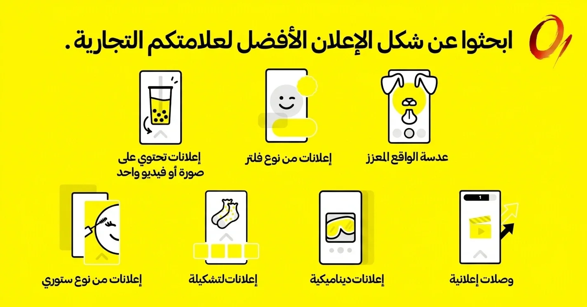
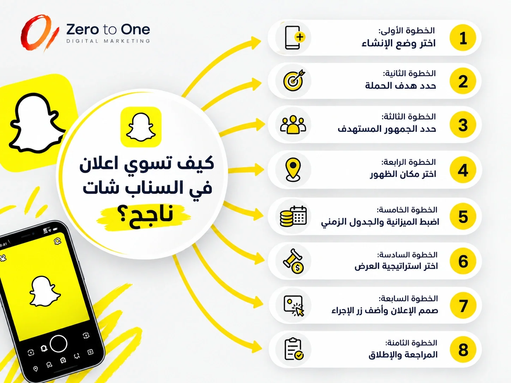

**أين يقضي ملايين المستهلكين في السعودية وقتهم كل يوم؟ الإجابة ببساطة: على سناب شات**. 

تذكر بعض التقارير أن الوصول الإعلاني للمنصة في المملكة يغطي نحو 89% من البالغين، وهي من أعلى نسب الوصول لمنصة اجتماعية في العالم. 

**لكل صاحب متجر أو شركة أو علامة تجارية واضح: عملاؤك القادمون موجودون على سناب الآن.**

وإذا كنت تسأل: "كيف اسوي اعلانات في السناب احترافية بفلوس؟ وما الفرق بين الإعلان المدفوع والنشر المجاني؟"، فهذا الدليل لك من خبراء شركة [زيرو تو وان افضل شركة تسويق إلكتروني في الرياض](https://zero2one.sa/ar/).

سنمشي معك من إنشاء الحساب الإعلاني في سناب شات بزنس، إلى اختيار نوع الإعلان، وضبط الاستهداف والميزانية، ومقاسات التصميم، وأخيرًا كيف تعرف أن إعلانك ناجح فعلًا.

## ما هي إعلانات سناب شات؟

إعلانات سناب شات إعلانات مدفوعة تظهر للمستخدمين بين القصص ومقاطع الفيديو التي يشاهدونها يوميا، وتتيح لك عرض منتجاتك أو خدماتك أمام ملايين المستخدمين النشطين عبر محتوى بصري (صور وفيديو) مصمم للجوال ويملأ الشاشة بالكامل.

وتُدار كل الإعلانات من منصة واحدة هي مدير إعلانات سناب شات (Snapchat Ads Manager)، ومنها تنشئ الحملة الإعلانية وتحدد جمهورك وميزانيتك وتتابع النتائج.

## ما الذي يميز إعلانات سناب شات؟

تذكر بيانات سناب شات الرسمية أن 3 من كل 4 مستخدمين يرون أن وقتهم على المنصة هو الأكثر قيمة مقارنة بمنصات المراسلة الأخرى، وأن المستخدمين أكثر تقبلًا للإعلانات فيها. وأبرز ما يميز اعلان سناب شات:

- **طبيعة العرض**: إعلانات رأسية تملأ الشاشة، بدون زحام نصوص أو إعلانات مجاورة كما في منصات أخرى.
- **أماكن الظهور**: بين القصص (Stories)، وفي منصة الأضواء (Spotlight)، وفي قسم اكتشف (Discover)، أو كعدسات وفلاتر تفاعلية داخل الكاميرا.
- **الجمهور**: حضور قوي لفئة 18–34 سنة، وهي الفئة الأكثر تسوقًا عبر الإنترنت.
- **طريق مباشر للمتجر**: سلوك السحب للأعلى (Swipe Up) يختصر خطوات العميل للوصول إلى متجرك أو صفحة الهبوط.
- **استهداف دقيق**: حسب المدينة والعمر والاهتمامات والسلوك ونوع الجهاز.
- **مناسبة لكل الميزانيات**: تقدر تبدأ بمبلغ بسيط يوميًا وتكبّر الصرف مع النتائج.

## الإعلان المدفوع مقابل النشر المجاني على سناب

النشر المجاني يحافظ على عملائك الحاليين ويبني ثقتهم، أما اعلان سناب شات المدفوع فهو جالب العملاء الجدد والمبيعات:

| **المعيار** | **النشر المجاني (القصص العادية)** | **الإعلان المدفوع** |
| **الوصول** | متابعوك الحاليون ومن يبحث عنك فقط | عملاء جدد لا يعرفون حسابك من قبل |
| **الاستهداف** | لا يوجد | حسب المدينة والعمر والجنس والاهتمامات |
| **التكلفة** | مجاني | ميزانية يومية أو إجمالية تحددها بنفسك |
| **التتبع** | إحصائيات بسيطة كعدد المشاهدات | تقارير متقدمة: التحويلات، تكلفة النقرة، العائد على الإنفاق الإعلاني ROAS |
| **السرعة** | بناء الجمهور يأخذ وقتًا طويلًا | نتائج سريعة بمجرد إطلاق الحملة |

**والأفضل أن تجمع بينهما**: محتوى مجاني منتظم يبني الثقة، وإعلانات ممولة توصلك لجمهور جديد.

قبل أن تبدأ جهز الحساب الإعلاني في سناب شات بزنس

إنشاء الحساب الإعلاني

تبدأ من منصة سناب شات بزنس بإنشاء حساب أعمال: اسم النشاط التجاري، والبريد الإلكتروني الرسمي، وكلمة المرور، وتاريخ الميلاد. 

بعدها تكمل الملف التعريفي باسم مستخدم متناسق مع علامتك، وصورة الشعار، ورقم الجوال والدولة، حتى يصبح حساب سناب الإعلاني جاهزًا لإطلاق الحملات.

## حسابات إعلانية متعددة داخل حساب البزنس

إذا كنت تدير أكثر من نشاط، أو تعمل كوكالة أو ميديا باير (Media Buyer) لعدة عملاء، فخصص حسابًا إعلانيًا مستقلًا لكل نشاط. 

تتيح لك المنصة إنشاء عدة حسابات إعلانية تحت حساب أعمال واحد (Business Center)، فتتجنب الخلط المالي والإداري وتبقى تقارير كل نشاط منفصلة.

طرق الدفع

**حتى يصبح الحساب نشط (Active)، أضف وسيلة دفع:**

- **بطاقات الائتمان والخصم (Credit / Debit Cards)**: الأسهل والأكثر شيوعًا للمتاجر الناشئة والمتوسطة.
- **باي بال (PayPal)**: خيار إضافي في بعض الحسابات.
- **الخط الائتماني (Line of Credit)**: للشركات ذات الإنفاق الشهري المرتفع جدًا.

### إدارة الصلاحيات وأعضاء الفريق

تقدر تدعو أعضاء فريقك أو عملاءك وتحدد صلاحياتهم بدقة، مثل "مسؤول المؤسسة" للتحكم الكامل في إعدادات البزنس، أو "مسؤول الحساب الإعلاني" لإدارة الحملات وإيقافها وتحليل النتائج. 

وهذه الميزة مهمة إذا كان متجرك يُدار من فريق أو من شركة إعلانات سوشيال ميديا.

### تثبيت Snap Pixel

البكسل كود صغير تضعه في موقعك أو متجرك، ويقيس ما يفعله الزائر بعد الإعلان: مشاهدة منتج، إضافة للسلة، شراء. بدونه لن تعرف بدقة هل إعلانك يبيع أم لا، ولن تقدر تسوي إعادة استهداف لزوار متجرك. 

ومنصات المتاجر المعروفة في السعودية مثل سلة وزد توفر ربطًا مباشرًا له.

## انواع اعلانات سناب شات وأيها يناسب نشاطك

كل شكل إعلاني صمم لهدف محدد، واختيار النوع الصحيح نصف نجاح الحملة. وهذه نظرة سريعة على كل نوع:

### 1. إعلانات الصورة أو الفيديو الفردي (Single Image or Video Ads)

تستخدم صورة أو فيديو رأسي يظهر بين القصص أو في Spotlight أو Discover، ويمكن ربطه بموقع أو تطبيق أو عدسة. كما انه بسيط وسريع الإنتاج ويناسب أغلب الأهداف.

تختاره لعرض منتج واحد أو خدمة أو عرض محدد، وهو نقطة البداية المثالية لأول حملة.

### 2. إعلانات المجموعات (Collection Ads) - منتجات في إعلان واحد

إعلانات المجموعات هو فيديو أو صورة رئيسية في الأعلى، وتحتها 4 مربعات لمنتجات قابلة للنقر. يختصر الطريق من المشاهدة إلى الشراء، لأن العميل يرى أكثر من منتج في إعلان واحد.

ينجح مع المتاجر الإلكترونية التي تبيع منتجات متعددة مثل الأزياء والعطور والإلكترونيات.

### 3. الإعلانات الديناميكية (Dynamic Ads) - لكل عميل

الإعلانات الديناميكية هي إعلانات تنشأ تلقائي من كتالوج منتجاتك، فتعرض لكل عميل المنتجات التي تصفحها أو أبدى اهتماما بها. لتخاطب كل عميل بما يهمه هو، وهي من أقوى أدوات إعادة الاستهداف.

ينجح مع المتاجر الكبيرة ذات المنتجات الكثيرة. ويتطلب ربط الكتالوج في مدير الإعلانات، وتثبيت البكسل، وتجميع بيانات كافية من الزوار.

### 4. إعلانات القصص (Story Ads) - لإطلاق منتج أو شرح خدمة

إعلانات القصص هو مربع يظهر في قسم "اكتشف"، وعند الضغط عليه تفتح سلسلة من 3 إلى 20 مقطع متتالي. يعطيك مساحة لسرد قصة أو شرح منتج بالتدريج. عندما تريد لإطلاق مجموعة منتجات، أو شرح خدمة تحتاج تفاصيل، أو سلسلة عروض موسمية.

### 5. الإعلانات التجارية (Commercials) - بناء الوعي

فيديو يظهر داخل محتوى Discover، وأول 6 ثوان منه لا يمكن تخطيها، ويمكن أن يمتد حتى 3 دقائق. ينجح لانه يضمن أن تصل رسالتك الأساسية كاملة قبل أن يتخطى المستخدم. تختاره لبناء الوعي بالعلامة التجارية وإيصال رسالة واضحة ومباشرة.

### 6. الفلاتر الممولة (Sponsored Filters) - لافتتاح فرع أو مناسبة

تصاميم تظهر فوق الصورة أو الفيديو بعد التقاط السناب، وتأتي بنوعين:

- **فلاتر مكانية**: مرتبطة بموقع محدد مثل مطعم أو معرض أو فعالية.
- **فلاتر الجمهور**: مرتبطة باهتمامات الجمهور بغض النظر عن مكانه.

ينجح المستخدم نفسه ينشر علامتك لأصدقائه. تختاره لافتتاح فرع، أو حدث، أو مناسبة مثل اليوم الوطني ورمضان.

### 7. عدسات الواقع المعزز (AR Lenses) - تجربة ممتعة

ما هو: عدسات تفاعلية بالكاميرا الأمامية لتجربة منتجات مثل النظارات ومستحضرات التجميل، أو بالكاميرا الخلفية لإضافة عناصر ثلاثية الأبعاد في المكان.

لماذا ينجح: تجربة ممتعة يتذكرها المستخدم ويشاركها. تختاره للحملات الكبيرة وإطلاق المنتجات التي يُفضّل أن يجربها العميل قبل الشراء.

مقارنة سريعة:

| **نوع الإعلان** | **الهدف الأنسب** | **يناسب** |
| **صورة أو فيديو فردي** | زيارات ومبيعات وتوعية | كل الأنشطة، والبداية |
| **المجموعات** | مبيعات مباشرة | المتاجر الإلكترونية |
| **الديناميكية** | إعادة الاستهداف | المتاجر ذات الكتالوج الكبير |
| **القصص** | شرح وسرد | الخدمات والمنتجات المتعددة |
| **التجارية** | وعي بالعلامة | العلامات التي تبني حضورًا |
| **الفلاتر** | انتشار وتفاعل | الأحداث والفروع الجديدة |
| **عدسات AR** | تفاعل وتجربة | التجميل والأزياء والحملات الكبيرة |

**تعرف علي**: [ادراة حملات اعلانية علي السوشيال ميديا](https://zero2one.sa/ar/services/digital-advertising/)

## كيف اسوي اعلانات في السناب شات؟ الخطوات الأساسية

طريقة عمل اعلان على سناب شات ليست معقدة، والأهم أن تأخذ كل قرار بوعي. وهذه الخطوات باختصار:

### الخطوة الأولى: اختر وضع الإنشاء

داخل مدير الإعلانات ستجد خيارين:

- **الإنشاء الفوري (Instant Create)**: إعلان سريع في دقائق، ويقدر يستورد صور منتجاتك مباشرة من رابط موقعك، أو يستخدم قصصك المحفوظة. مناسب للمبتدئين ولحملات الوعي العامة، وتذكّر دائمًا: من لا يعرفك لا يشتري منك.
- **الإنشاء المتقدم (Advanced Create)**: الخيار الاحترافي، وفيه تتحكم في الميزانية والاستهداف واستراتيجية العرض وتقدر تسوي أكثر من إعلان واختبارات A/B داخل نفس الحملة.

### الخطوة الثانية: حدد هدف الحملة

الهدف يحدد لمن تعرض المنصة إعلانك. اسأل نفسك: هل تريد

- زيارات لمتجرك أو موقعك؟
- مبيعات وتحويلات مباشرة؟
- تثبيت تطبيق أو مشاهدات فيديو؟
- رسائل أو اتصالات مباشرة؟
- زوار لموقعك الفعلي مثل المعرض أو المطعم؟

وسمِّ الحملة باسم واضح (مثل: "عطور – رمضان – الرياض") حتى تتابعها بسهولة لاحقًا.

### الخطوة الثالثة: حدد الجمهور المستهدف

السر الحقيقي في نجاح إعلانات سناب شات هو دقة الاستهداف:

- الموقع الجغرافي: الدولة أو المدينة (الرياض، جدة، الدمام) أو نطاق محدد.
- البيانات الديموغرافية: العمر والجنس واللغة.
- الاهتمامات والسلوكيات: المهتمون بالتسوق أو الموضة أو السفر أو التقنية.
- نوع الجهاز: آيفون أو أندرويد.
- الجماهير المخصصة: زوار متجرك أو قائمة عملائك، والجماهير المشابهة لهم (Lookalike).

وإذا كنت متأكدًا من معايير جمهورك، فكّر في إلغاء خيار توسيع الجمهور تلقائيًا حتى يصل إعلانك لمن يهمك فعلًا.

### الخطوة الرابعة: اختر مكان الظهور

الموضع التلقائي يعطي المنصة حرية توزيع الإعلان بين القصص وSpotlight وDiscover للوصول لأكبر عدد. أما إذا كان عندك سبب واضح، مثل أن إعلانك يناسب محتوى Discover، فاختر الموضع يدويًا.

### الخطوة الخامسة: اضبط الميزانية والجدول الزمني

- الميزانية اليومية: مبلغ ثابت يُصرف كل يوم.
- الميزانية الإجمالية: سقف للحملة كاملة.
- تاريخ البداية والنهاية: حتى تتوقف الحملة تلقائيًا ولا تستنزف الميزانية.

وفي فترات ذروة الأداء، لا تقيّد الحملة بحدود صارمة جدًا حتى لا تتوقف فجأة وهي تبيع.

الخطوة السادسة: اختر استراتيجية العرض

الإعلانات على سناب تعمل بنظام المزاد اللحظي. ومن الخيارات المتاحة:

- العرض التلقائي (Auto-bid): المنصة تحاول تحقيق أكبر عدد من النتائج بميزانيتك.
- التكلفة المستهدفة (Target Cost): تحدد متوسط المبلغ الذي تريد دفعه مقابل إجراء معين، مثل نقرة على الرابط أو مشاهدة صفحة منتج، فتضبط الإنفاق وتقلل الصرف العشوائي.

### الخطوة السابعة: صمم الإعلان وأضف زر الإجراء

ارفع الفيديو أو الصورة، وأضف اسم العلامة التجارية وعنوانًا قصيرًا، ثم اختر زر الدعوة لاتخاذ إجراء (CTA) المناسب: "تسوق الآن"، "احجز الآن"، "راسلنا"، أو "اتصل الآن". ويمكنك ربط الإعلان بمتجرك، أو بصفحة هبوط، أو مباشرة بالواتساب لإتمام البيع ومحادثة العميل.

### الخطوة الثامنة: المراجعة والإطلاق

راجع كل شيء من المعاينة الحية (Preview): الهدف والاستهداف والميزانية والتصميم والرابط، ثم اضغط "نشر". تمر الإعلانات بمراجعة المنصة قبل أن تبدأ بالظهور، فخذ ذلك في حسابك قبل المواسم والعروض.

**تعرف علي**: [كيف تسوق منتج الكترونيا](https://zero2one.sa/blog/ar/how-to-market-product-in-saudi-arabia/)

## مقاس تصميم اعلان سناب شات ومواصفاته

حتى يظهر إعلانك احترافيًا، التزم بالمواصفات الفنية:

| العنصر | المواصفة |
| الأبعاد | 1080 × 1920 بكسل |
| نسبة العرض للارتفاع | 9:16 (رأسي) |
| مدة الفيديو | من 3 إلى 180 ثانية |
| حجم الفيديو | حتى 1 جيجابايت |
| حجم الصورة | حتى 5 ميجابايت |

واترك مساحة آمنة أعلى وأسفل الشاشة بلا نصوص مهمة، لأن اسم الحساب وزر الإجراء يظهران هناك.

أسرار تصميم إعلان سناب يبيع

### الثواني الأولى هي كل شيء (Hook)

المستخدم يتخطى بسرعة، وخصوصًا في الإعلانات القصيرة. ابدأ بالمشكلة أو بالنتيجة أو بلقطة تشد العين من أول ثانية، وقدّم القيمة الحقيقية لمنتجك قبل أن يقرر المشاهد أن يكمل أو يسحب. وفي الإعلانات غير القابلة للتخطي (أول 6 ثوانٍ)، خلّ رسالتك الأساسية كاملة داخل هذه الثواني.

### محتوى يشبه سناب لا يشبه التلفزيون

الإعلانات المصورة بالجوال وبأسلوب طبيعي، مع وجه شخص يتكلم باللهجة المحلية، تنجح غالبًا أكثر من الإعلانات المصقولة جدًا. صوّر منتجك الحقيقي، وأضف ترجمة نصية لأن كثيرين يشاهدون بدون صوت.

### رسالة واحدة وعرض واضح

لا تحشر كل مميزات   في إعلان واحد. ركز على فائدة واحدة وعرض واحد وزر إجراء واحد.

## كم تكلفة إعلان سناب شات؟

أسعار الإعلانات في السناب شات ليست ثابتة، لأنها تعتمد على نظام المزاد اللحظي. لكن الجيد أنك تقدر تبدأ بميزانية صغيرة:

- **الحد الأدنى للميزانية اليومية**: يبدأ من نحو 5 دولارات يوميا (قرابة 19 ريالا سعوديًا).
- **ميزانية مرحلة التعلم**: ينصح غالبا بنحو 20 إلى 50 دولار يوميا في الأيام الأولى، حتى تتعلم الخوارزمية سلوك جمهورك وتتحسن النتائج، وتستمر هذه المرحلة عادة عدة أيام.

### ما الذي يحدد تكلفة الإعلان؟

تكلفة اعلان سناب شات تتغير من حملة لأخرى حسب عدة عوامل. أولها هدف الحملة، فأهداف الشراء والتحويلات أغلى عادة من أهداف الوعي والمشاهدات، لأن المنصة تبحث لك عن أشخاص أقرب للشراء. 

وثانيها الجمهور المستهدف، فكلما كان الجمهور أضيق أو مطلوبًا من معلنين كثيرين، ارتفعت التكلفة.

وتؤثر أيضا المنافسة والموسم؛ فالأسعار ترتفع في رمضان والعيد واليوم الوطني والجمعة البيضاء لأن الجميع يعلن في نفس الوقت. 

أما جودة الإعلان فهي العامل الذي تتحكم فيه أنت مباشرة: الإعلان الجذاب يحقق تفاعلًا أعلى، فتكافئه المنصة بتكلفة أقل. وأخيرًا نوع الإعلان، فالعدسات والفلاتر الكبيرة تحتاج عادة ميزانيات أعلى من إعلانات الفيديو العادية.

وتحسب التكلفة غالبًا بنموذج التكلفة لكل ألف ظهور (CPM)، مع خيارات تعتمد على الهدف مثل تكلفة النقرة (CPC) أو تكلفة الإجراء (CPA).

### كيف تدير ميزانيتك بذكاء؟

- **ابدأ بمبلغ صغير**، واختبر أكثر من تصميم وجمهور، ثم ضاعف الصرف على الرابح فقط.
- **حدد مؤشرات النجاح** قبل الإطلاق، لا بعده.
- **وزع الميزانية حسب الهدف**: جزء للوعي وجزء للمبيعات وجزء لإعادة الاستهداف.
- **راجع الأداء بانتظام** وعدل بناء على العائد على الاستثمار (ROI)، لا على الإحساس.

وإذا كنت تبغى ميزانيتك تشتغل بكفاءة من أول يوم، تولّى فريق ZERO 2 ONE إدارة حملاتك الإعلانية على السوشيال ميديا: نوزع الميزانية حسب الهدف، ونختبر التصاميم والجماهير، ونوقف الإعلان الخاسر بسرعة ونكبّر الرابح، حتى يتحول كل ريال تصرفه إلى نتيجة تقدر تقيسها.

## كيف تعرف أن إعلانك على سناب شات ناجح؟

لا تكتفي بعدد المشاهدات. راقب هذه المؤشرات من لوحة الإعلانات:

1. **المبيعات والتحويلات**: المؤشر الأهم إذا كان هدفك الربح. ومع Snap Pixel تعرف بدقة هل العائد على الإنفاق الإعلاني (ROAS) أعلى من المبلغ الذي صرفته.
2. **نسبة النقر أو السحب (Swipe-up Rate)**: ارتفاعها يعني أن الإعلان جذاب ومحفز، ويتراوح المعدل الجيد في كثير من الحملات بين 0.5% و2%.
3. **وقت المشاهدة**: استمرار المشاهد بعد أول 3 ثوانٍ يعني أن افتتاحية الفيديو نجحت.
4. **تكلفة النقرة**: نقرات أكثر بتكلفة أقل تعني أن الإعلان مناسب لجمهوره.
5. **التفاعل والانتشار**: مشاركات الإعلان واستخدام العدسات والفلاتر ينشر علامتك بين أصدقاء المستخدمين مجانًا.
6. **معدل الارتداد**: إذا خرج الزائر فورًا من موقعك، فالمشكلة غالبًا في سرعة الصفحة أو عدم تطابقها مع الإعلان.

وتقدر تستخدم أداة A/B Testing داخل مدير الإعلانات للمقارنة بين نسختين من الإعلان، و Google Analytics لمتابعة سلوك الزوار القادمين من سناب داخل موقعك.

**يمكنك الاطلاع علي**: [إدارة إعلانات جوجل](https://zero2one.sa/ar/services/manage-google-adwords-campaigns/)

## متى تستعين بشركة إدارة حملات إعلانية؟

تقدر تطلق أول إعلان بنفسك، لكن الفرق بين إعلان يصرف وإعلان يربح يكمن في التفاصيل: الاستهداف، والتصميم، والاختبار المستمر، وقراءة الأرقام. 

وإذا كان وقتك أثمن من أن تقضيه في لوحة الإعلانات، أو صرفت ميزانية بدون نتائج واضحة، فالاستعانة بشركة إعلانات سوشيال ميديا متخصصة توفر عليك الكثير.

## كيف تساعدك ZERO 2 ONE في تحويل إعلانات سناب شات إلى أرباح حقيقية؟

في ZERO 2 ONE نقدم خدمة متكاملة لإدارة الحملات الإعلانية على السوشيال ميديا، وعلى رأسها سناب شات المنصة الأقوى في السوق السعودي. 

لا نكتفي بإطلاق إعلان عابر، بل نبني لك استراتيجية إعلانية واضحة الأهداف، وننفذها ونحسّنها باستمرار بناء على الأرقام:

- **نختار نوع الإعلان الأنسب لنشاطك**، ونوزع الحملات بين المحتوى وإعلانات المجموعات حسب هدفك.
- **نستهدف جمهورك بدقة حسب المدينة والعمر والاهتمامات**، ونعيد استهداف زوار متجرك لتحويلهم إلى مبيعات.
- **نصمم فيديوهات وإعلانات** تمسك انتباه العميل من الثواني الأولى.
- **نتابع البيانات** ونحللها باستمرار لنحقق أعلى عائد ممكن مقابل كل ريال.
- **نفهم سلوك الجمهور السعودي** والخليجي لأننا نعمل داخل السوق.
- **نتولى الربط التقني** مع موقعك أو متجرك، بما في ذلك البكسل والكتالوج.

سواء كنت تبدأ أول حملة أو تبغى تطور حملات قائمة ما جابت النتيجة المتوقعة، تواصل مع شركة[ ZERO 2 ONE أفضل شركة تسويق إلكتروني في السعودية](https://zero2one.sa/blog/ar/best-digital-marketing-agency-in-saudi-arabia/) اليوم وخل فريقنا يراجع حسابك الإعلاني ويقترح لك خطة حملات سوشيال ميديا مناسبة لنشاطك وميزانيتك.

### الخلاصة

صارت الإجابة عن سؤال "كيف اسوي اعلانات في سناب شات احترافية بفلوس؟" واضحة: حساب إعلاني مجهز بالبكسل، وهدف محدد، ونوع إعلان يناسب هذا الهدف، واستهداف دقيق، وتصميم رأسي يشد الانتباه من الثانية الأولى، وميزانية تبدأ صغيرة وتكبر مع النتائج. 

وسواء كنت تطلق متجرًا جديدًا أو توسّع مشروع قائم، ابدأ بحملة تجريبية بسيطة وتعلّم من أرقامها، أو ضع حملتك القادمة بين أيدي خبراء ZERO 2 ONE.

## الأسئلة الشائعة

### 1. هل إعلانات السناب موثوقة؟

نعم، تعتمدها شركات كبرى عالميًا ومحليًا، وتوفر لوحة تقارير وأدوات تتبع تساعدك على معرفة أين تُصرف ميزانيتك ومن يشاهد إعلانك.

### 2. هل اعلان سناب شات مجاني؟

لا، الإعلانات الممولة مدفوعة، لكنك تقدر تبدأ بميزانية صغيرة. أما نشر القصص من حسابك فمجاني، لكنه يصل لمتابعيك الحاليين فقط.

### 3. كم الحد الأدنى لميزانية إعلان سناب شات؟

يبدأ الحد الأدنى للميزانية اليومية من نحو 5 دولارات (قرابة 19 ريالًا سعوديًا)، ويُفضّل ميزانية أعلى قليلًا في البداية حتى تتعلم المنصة جمهورك.

### 4. كم مدة إعلان سناب شات؟

مدة مقطع الإعلان من 3 إلى 180 ثانية، لكن المقاطع القصيرة غالبًا أفضل أداءً. أما مدة عرض الحملة فتحددها أنت: يوم أو أسبوع أو مستمرة حتى توقفها.

### 5. ما مقاس تصميم اعلان سناب شات؟

1080 × 1920 بكسل بنسبة 9:16 الرأسية، وحتى 1 جيجابايت للفيديو و5 ميجابايت للصورة.

### 6. متى أقدر أسوي إعلان في السناب؟

في أي وقت من خلال مدير الإعلانات، مع إمكانية الإيقاف والتشغيل متى شئت. لكن جهّز حملات المواسم قبلها بوقت كافٍ لمراجعة الإعلانات واختبارها.

### 7. هل أقدر أقارن بين أكثر من إعلان؟

نعم، عبر خاصية اختبار A/B في مدير الإعلانات، لمقارنة التصاميم أو الجماهير أو العروض.

### 8. هل إعلان سناب شات يناسب المشاريع الصغيرة؟

نعم، يناسب المشاريع الصغيرة والكبيرة، لأن الميزانية مرنة والاستهداف يسمح لك بالتركيز على مدينة أو فئة محددة.

### 9. ما أفضل شركة لعمل إعلان سناب شات في السعودية؟

ابحث عن شركة تعرض نتائج حقيقية في مجالك وتقدم تقارير واضحة. وتقدم ZERO 2 ONE إدارة متكاملة لحملات سناب شات، من الاستراتيجية والتصميم إلى الاستهداف وتحليل النتائج.
