اشهر [محرك بحث](https://ar.wikipedia.org/wiki/%D9%85%D8%AD%D8%B1%D9%83_%D8%A8%D8%AD%D8%AB) عالميا هو جوجل يستحوذ علي 91.05%، ثم بينج 4.8%، ثم ياهو 1.18%، حسب بيانات StatCounter لشهر أكتوبر 2026.

الارقام لا تحكي القصة كاملة. الذكاء الاصطناعي غير شكل صفحة النتائج نفسها في جوجل صار يجيب عن السؤال بملخص في أعلى الصفحة، وملايين الناس يسألون ChatGPT وPerplexity قبل أن يفتحوا أي موقع. 

وهذا يعني أن سؤال "أي محرك بحث أستخدم؟" لم يعد سؤال المستخدم فقط، بل صار سؤال مصيري لكل صاحب موقع أو متجر يبغى العملاء يجدونه.

نشرح لك كيف تعمل محركات البحث، وأشهر 10 محركات بحث عالمية وحصة كل واحد منها، ومكان الذكاء الاصطناعي في المعادلة، وكيف تحسن ترتيب موقعك مع [خدمات السيو SEO في الرياض](https://zero2one.sa/ar/services/seo-riyadh/) مع شركة زيرو تو وان.

## ما هي محركات البحث؟ وكيف تعمل؟

محرك البحث نظام إلكتروني يساعدك في إيجاد المعلومات والصور ومقاطع الفيديو والأخبار على شبكة الإنترنت. تكتب سؤالك، فيعرض لك في أجزاء من الثانية الصفحات الأقرب لما تبحث عنه. وتتشابه محركات البحث في فكرتها، لكنها تختلف في دقة النتائج وعددها وطريقة ترتيبها.

**ويعمل أي محرك بحث عبر ثلاث مراحل:**

1. **الزحف (Crawling)**: برامج آلية تجوب الويب وتتبع الروابط لاكتشاف الصفحات الجديدة والمحدثة.
2. **الفهرسة (Indexing)**: تحلل كل صفحة ويخزن محتواها في قاعدة بيانات ضخمة تشبه فهرس مكتبة عملاقة.
3. **الترتيب (Ranking)**: عند كل عملية بحث، ترتب الصفحات المفهرسة حسب مئات الإشارات: ملاءمة المحتوى للسؤال، وجودته، وسرعة الصفحة، والروابط الواردة إليها، وغيرها.

## كيف تساعد محركات البحث في إيجاد المعلومات والصور؟

عند إدخال استفسار معين في محرك البحث، يحدد الصفحات الأكثر صلة بهذا الاستفسار بناء على مجموعة من العوامل، مثل الكلمات المفتاحية وجودة المحتوى وعدد الروابط المؤدية إلى الصفحة. 

فإذا كنت تبحث عن مقال حول "التسويق الإلكتروني"، سيعرض لك المحرك المقالات التي تتناول الموضوع في عنوانها أو نصها، ويقدم منها ما يحتوي على معلومات موثوقة ومحدثة. 

ومحركات البحث الحديثة لا تكتفي بمطابقة الكلمات، بل تحاول فهم المعنى والنية وراء السؤال، فتظهر لك صفحة مفيدة حتى لو استخدمت كلمات مختلفة عن كلماتها.

### دور محركات البحث في إيجاد الصور

لا تقتصر وظيفة محركات البحث على عرض النصوص، بل تشمل الصور والفيديوهات أيضا. فعندما يبحث المستخدم عن صورة معينة، مثل صورة لمنتج أو خدمة، تحلّل محركات البحث البيانات الوصفية المرتبطة بالصورة: اسم الملف، والنص البديل (Alt Text)، والعنوان، والنص المحيط بها في الصفحة.

 ومع تقنيات الذكاء الاصطناعي، صارت المحركات تفهم محتوى الصورة نفسه، بل وتتيح البحث بالصورة عبر أدوات مثل Google Lens، فتصور منتج وتجد أماكن بيعه ومنتجات مشابهة له.

## كيف تحسن ظهور موقعك في محركات البحث؟

للظهور في جوجل عن طريق البحث العضوي، واجابات الذكاء الاصطناعي وايضا ظهور موقعك في خرائط جوجل. 

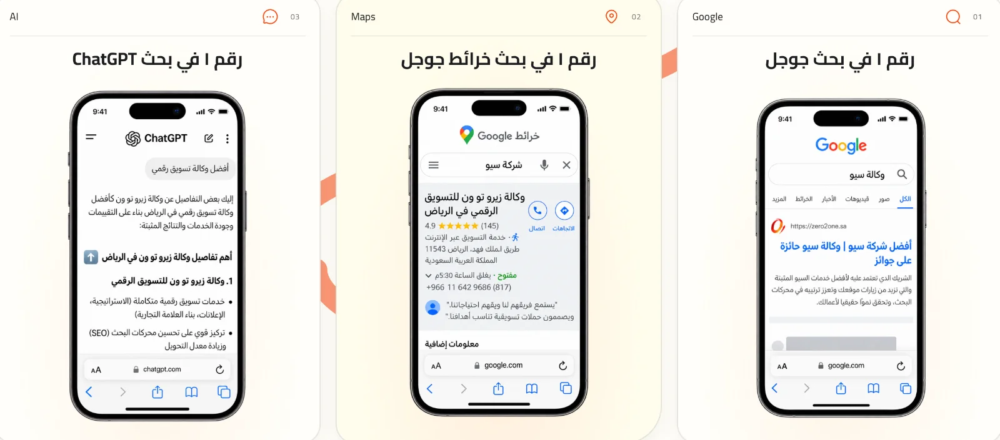

هنا يأتي دور تحسين محركات البحث (SEO) هو مجموعة ممارسات تقنية ومحتوائية تجعل موقعك سهل الزحف والفهرسة، ومحتواه أفضل إجابة لسؤال الباحث. وتشمل خدمات السيوSEO الاتي:

- **السيو التقني**: سرعة الموقع، والفهرسة، وملف robots.txt، وخريطة الموقع، والتوافق مع الجوال.
- **سيو المحتوى (On-Page)**: اختيار الكلمات المفتاحية، وكتابة محتوى يجيب عن نية البحث، والربط الداخلي.
- **السيو الخارجي (Off-Page)**: بناء السمعة والروابط من مواقع موثوقة.
- **وظهر محور رابع**: الظهور داخل إجابات الذكاء الاصطناعي.

## أشهر محركات البحث العالمية بالأرقام

يعتبر اشهر محركات البحث العالمية هو جوجل يستحوذ علي 91.05% بواقع 5 تريليون عملية بحث يومية. 

هذه حصص محركات البحث من إجمالي عمليات البحث عالميًا وفي السعودية، حسب [StatCounter](https://gs.statcounter.com/search-engine-market-share) (أكتوبر 2026، كل الأجهزة):

| **محرك البحث** | **الحصة العالمية** | **الحصة في السعودية** |
| جوجل (Google) | 91.05% | 96.1% |
| بينج (Bing) | 4.8% | 2.69% |
| ياهو (Yahoo!) | 1.18% | 0.24% |
| ياندكس (Yandex) | 1.14% | 0.7% |
| DuckDuckGo | 0.64% | 0.14% |
| بايدو (Baidu) | 0.42% | — |

وما تبقى، وهو أقل من 1% مجتمع، يتوزع على Ecosia وBrave Search وStartpage وNaver ومحركات محلية أصغر.

ملاحظة مهمة عن الأرقام: ستقرأ في مواقع كثيرة أن حصة جوجل "انهارت" إلى 89% أو أقل. أغلب هذه الأرقام تقيس شيئا مختلفا: أجهزة سطح المكتب وحدها، أو شهرا معينا، أو حصة الإحالات بدل حصة عمليات البحث.

## انواع محركات بحث عالميآ

لكل محرك فهرس مختلف، وخوارزمية مختلفة، وجمهور مختلف. والمحرك الذي يأتي سابعا عالميا قد يكون الأول في سوق بلد آخر.

### محركات البحث الرئيسية القائمة على الزحف

#### 1. جوجل (Google) اشهر محرك بحث في العالم

 اشهر محرك بحث في العالم")

حصته 91.05% عالميًا و96.1% في السعودية، وأعلنت جوجل أنها تعالج أكثر من 5 تريليونات عملية بحث سنويًا. انطلق عام 1998 من مشروع بحثي في جامعة ستانفورد، وبنى تفوقه على خوارزمية PageRank التي رتّبت الصفحات حسب الروابط الواردة إليها بدل تكرار الكلمات.

**لماذا تستخدمه؟** اضخم فهرس ويب في العالم، وأفضل فهم للغة العربية بجذورها وتصريفاتها ولهجاتها، وتكامل مع خرائط جوجل ويوتيوب والترجمة ومتصفح كروم ونظام أندرويد.

**يجب أن تعرف ان** ملخصات الذكاء الاصطناعي (AI Overviews) التي يعرضها أعلى النتائج تجيب عن السؤال داخل الصفحة، فيقل عدد من ينقر على المواقع في بعض الأسئلة.

**يهمك اذا كان لذيك موقع أو متجر يستهدف السعودية أو الخليج يبدأ من جوجل، لأنه عمليا السوق كلها تقريبا.**

**تعرف علي:** [كيف اعمل اعلان في غوغل؟](https://zero2one.sa/blog/ar/how-to-make-google-ad/)

#### 2. بينج (Bing) مايكروسوفت

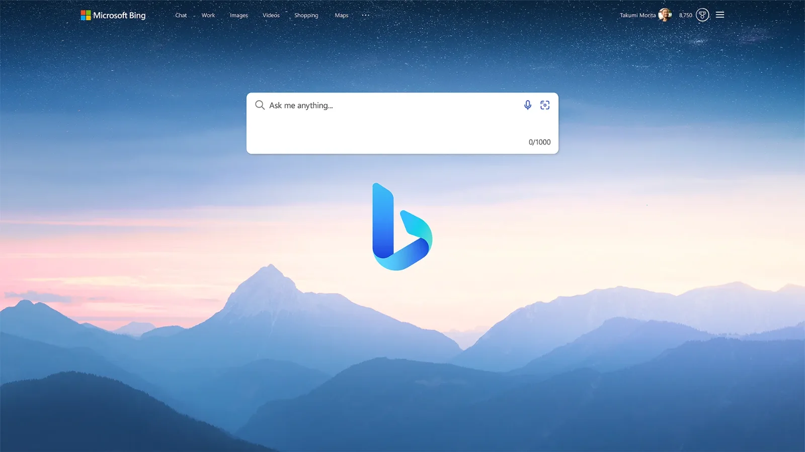

حصته 4.8% عالميًا و2.69% في السعودية، وهو الثاني بلا منازع. أطلقته مايكروسوفت عام 2009 خلفا لـ MSN Search وLive Search. وزنه الحقيقي أكبر من رقمه العالمي، لأنه المحرك الافتراضي في ويندوز ومتصفح إيدج، وحصته على أجهزة سطح المكتب أعلى بكثير. ومن المهم أن تعرف أن فهرس بينج يغذي محركات أخرى مثل ياهو، ويغذي جزئيا DuckDuckGo وEcosia.

**لماذا تستخدمه؟** بحث الصور والفيديو فيه مميز، ويدمج Microsoft Copilot بين نتائج البحث والإجابة التوليدية. ولأصحاب المواقع، تعطيك Bing Webmaster Tools بيانات مفيدة بجانب Google Search Console.

إذا كان جمهورك من موظفي الشركات الذين يعملون على ويندوز (خدمات B2B مثلًا)، فتجاهل بينج قرار مكلف.

#### 3. ياهو (Yahoo!) أقدم محرك بحث ما زال يعمل

حصته 1.18% عالميًا. انطلق عام 1994 كدليل مواقع مصنف يدويا، ثم تحول إلى محرك بحث. اليوم تعتمد نتائجه على فهرس بينج، فما تراه فيه قريب مما تراه في بينج، لكن بطريقة عرض مختلفة.

**لماذا تستخدمه؟** إذا كنت تعتمد على خدمات ياهو مثل البريد وYahoo Finance، فنتائجه تدمج هذه البيانات مباشرة، وقسم الأخبار فيه قوي. وحضوره في اليابان أقوى بكثير من حضوره العالمي.

**معلومة مفيدة لأصحاب المواقع** تحسين موقعك لبينج يحسنه لياهو تلقائيا، فلا تعامله كمشروع منفصل.

#### 4. ياندكس (Yandex) محرك بحث روسي

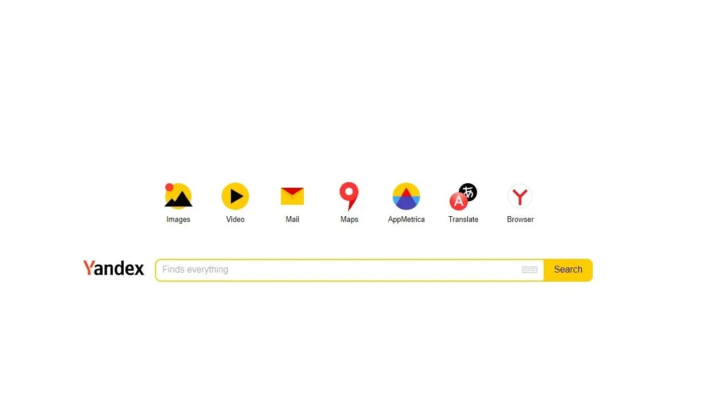

حصته 1.14% عالميًا، لكنه المسيطر الأول داخل روسيا بفارق واضح عن جوجل. تأسس عام 1997، ويقدم إلى جانب البحث خرائط وبريدا وترجمة وتخزين سحابي ومتصفح خاص به.

**لماذا تستخدمه؟** البحث بالصورة فيه يعطي نتائج مختلفة عن جوجل، وكثيرًا ما يستخدمه الصحفيون والباحثون للتحقق من الصور والأماكن والمنتجات. وله حضور صغير لكن ملحوظ في السعودية (0.7%)، أعلى من ياهو هنا.

**متى يهمك؟** إذا كان جمهورك في روسيا أو آسيا الوسطى، فأنت بحاجة إلى Yandex Webmaster بجانب أدوات جوجل.

#### 5. بايدو (Baidu) محرك بحث صيني

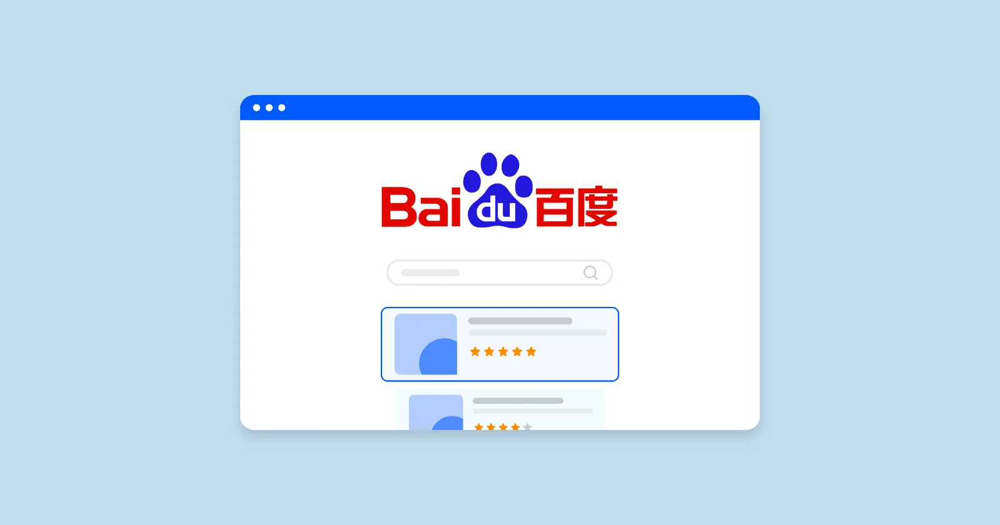

حصته 0.42% عالميا، لكنه الأول في الصين حيث حضور جوجل ضعيف جدا. تأسس عام 2000، وخدماته مبنية للمستخدم الصيني. الظهور فيه مشروع مستقل بذاته، يتطلب غالبًا استضافة داخل الصين وترخيص ICP، 

**ولا يهمك إلا إذا كنت تستهدف السوق الصيني.**

### **محركات بحث تركز على الخصوصية**

#### 1. DuckDuckGo 

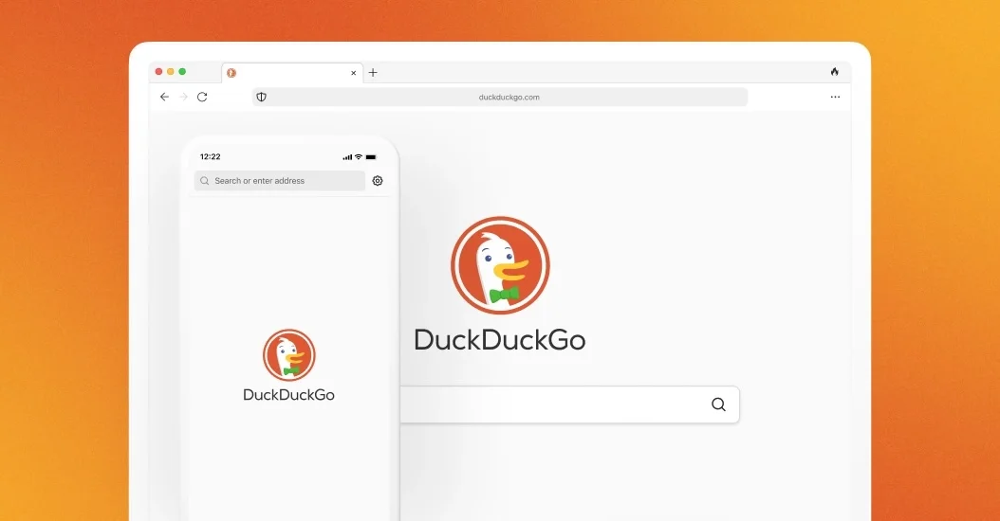

حصته 0.64% عالميا. أطلق عام 2008 على مبدأ واحد: **لا يخزن سجل بحثك ولا يبني عنك ملف إعلاني**، فكل من يبحث عن الكلمة نفسها يرى النتائج نفسها. ومن ميزاته اختصارات Bangs (مثل !w للانتقال مباشرة إلى ويكيبيديا)، ووضع بحث بلا ذكاء اصطناعي عبر noai.duckduckgo.com.

**متى تختاره؟** إذا كانت الخصوصية أولويتك، أو كنت تبغى نتائج غير مخصصة حسب سجلك.

#### 2. Brave Search 

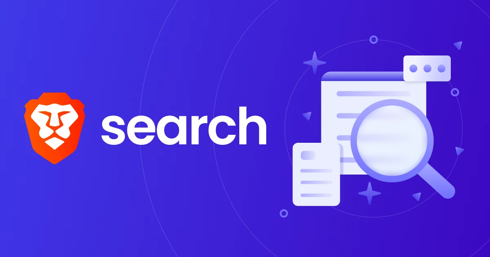

أطلق عام 2021 من شركة متصفح Brave، وهو من المحركات القليلة التي تملك فهرس خاص بها لا يعتمد على جوجل أو بينج. يجمع بين استقلال الفهرس ورفض التتبع، ويعرض إجابة مولّدة بالذكاء الاصطناعي أعلى النتائج.

#### 3. Startpage نتائج جوجل بدون تتبع

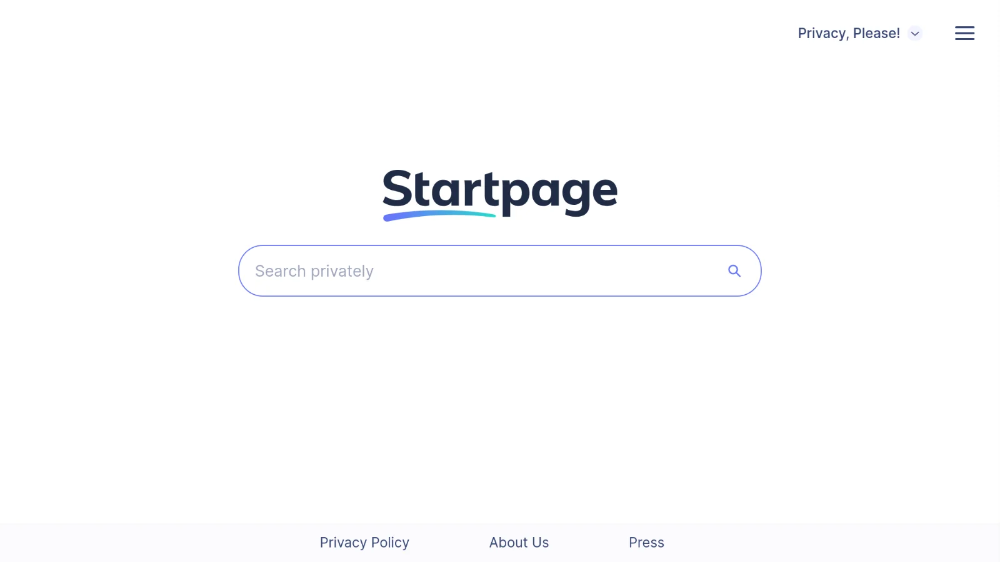

محرك هولندي يعرض نتائج جوجل لكن دون تخزين عنوان IP أو سجل البحث، ويوفر ميزة "العرض المجهول" لزيارة المواقع عبر وسيط. يناسب من يبغى جودة جوجل مع خصوصية أعلى.

### محركات البحث والإجابة المعتمدة على الذكاء الاصطناعي

#### 1. ChatGPT Search من OpenAI

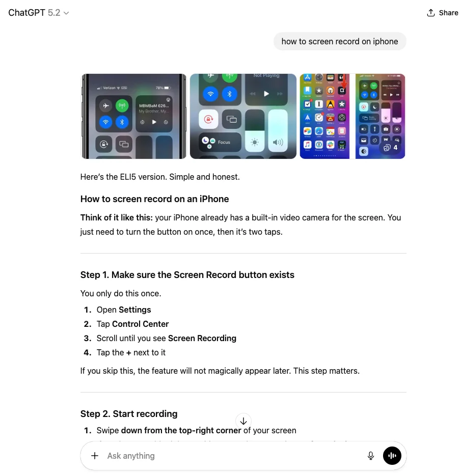

ChatGPT بدأ كمساعد محادثة، لكن منذ أن أطلقت OpenAI خاصية البحث في أكتوبر 2024 (إعلان OpenAI)، صار يبحث في الويب لحظة السؤال ويرد بإجابة مربوطة بمصادرها. وهو اليوم أكثر أداة ذكاء اصطناعي استخداما في العالم، وكثيرون صاروا يسألونه قبل أن يفتحوا جوجل.

بالأرقام: أعلنت OpenAI في فبراير 2026 أن عدد مستخدمي ChatGPT النشطين أسبوعيًا وصل إلى 900 مليون مستخدم، بعد 800 مليون في أكتوبر 2025، إلى جانب 50 مليون مشترك مدفوع (TechCrunch، فبراير 2026).

**أبرز مميزاته**

بحث لحظي مع المصادر: يجلب معلومات حديثة من الويب ويعرض روابط المواقع التي اعتمد عليها.

- **فهم الأسئلة المركبة**: تكتب سؤالك بلغتك الطبيعية، حتى باللهجة، ويربط المعلومات ببعضها في إجابة واحدة.
- **محادثة متصلة**: تكمل بأسئلة متابعة دون إعادة شرح السياق.
- **أكثر من البحث**: يلخص ويكتب ويحلل الملفات، فينتقل بك من السؤال إلى إنجاز المهمة نفسها.
- **متى تختاره؟** للشرح والتلخيص والمقارنات وتخطيط المهام. أما للتحقق من رقم دقيق أو خبر عاجل أو معلومة طبية، فارجع إلى المصدر الأصلي.

**الإيجابيات**: قاعدة مستخدمين ضخمة، وفهم قوي للغة الطبيعية، ويجمع البحث والعمل في مكان واحد.

**السلبيات**: قد يخطئ في الوقائع الحديثة، ولا يعرض دائمًا كل مصادره بوضوح، وبعض المزايا متاحة فقط في الخطط المدفوعة.

**لأصحاب المواقع**: مع هذا الحجم من المستخدمين، صار ظهور علامتك داخل إجابات ChatGPT قناة ظهور لا يمكن تجاهلها. ويبدأ ذلك بأن يكون موقعك قابلًا للزحف، ومحتواك واضحًا ودقيقًا ويصلح لأن يستشهد به. الرابط الرسمي: [chatgpt.com](chatgpt.com).

#### 2. Perplexity AI محرك بحث بالذكاء الاصطناعي

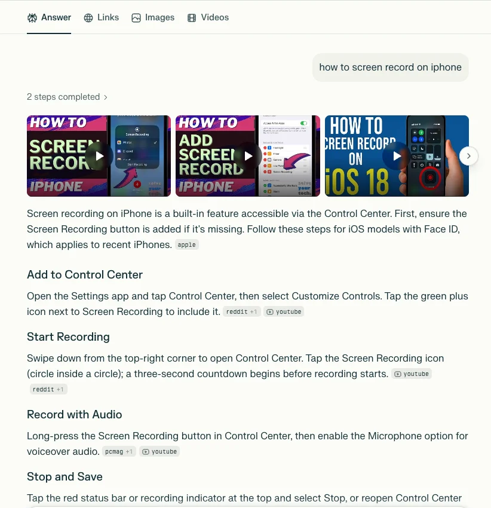

تم اطلاق Perplexity عام 2022، وصار بسرعة من أبرز اللاعبين الجدد في عالم البحث. بدل أن يعطيك قائمة روابط، يبحث في الويب لحظة سؤالك ثم يكتب لك إجابة مفصلة مع ذكر مصادرها، وكأنك تسأل مساعد بحث يجمع المعلومات من أكثر من موقع ويرتبها لك. وهو أشبه بنسخة من ملخصات جوجل الذكية.

**مميزات Perplexity AI**

- **اجابات موثقة بالمصادر**: كل معلومة مربوطة برابط مصدرها، فتقدر تتحقق بنفسك.
- **معلومات حديثة**: يبحث في الويب مباشرة، فلا يعتمد فقط على بيانات تدريب قديمة.
- **اسئلة المتابعة**: تكمل الحوار وتسأل عن تفاصيل الإجابة دون أن تبدأ بحث جديد.
- **نسخة Pro مدفوعة**: تضيف نماذج ذكاء اصطناعي متقدمة وإجابات أطول وتوليد صور، بينما تبقى النسخة الأساسية مجانية.

**متى تختاره؟** للأسئلة البحثية المركبة التي تحتاج عادة أكثر من عملية بحث في جوجل، وحين يهمك أن ترى المصدر بنفسك. أما للبحث السريع عن معلومة واحدة أو موقع محدد، فالمحرك التقليدي أسرع.

**الإيجابيات**: إجابات مفصلة وموثقة بدل قائمة روابط، ومعلومات لحظية، وحوار بحثي متصل.

**السلبيات**: بعض المزايا تحتاج اشتراك Pro، والأسلوب الحواري أبطأ في الأسئلة البسيطة، وما زالت الإجابات المولدة تحتاج تحققا في الموضوعات الحساسة مثل المجال الطبي.

**لأصحاب المواقع**: لأن Perplexity يذكر مصادره بالرابط، فظهور موقعك ضمن هذه المصادر فرصة حقيقية لزيارات مؤهلة، وهذا جزء مما يستهدفه تحسين الظهور في محركات الذكاء الاصطناعي (GEO). الرابط الرسمي: [perplexity.ai](perplexity.ai).

### محركات بحث أخري

#### 7. Ecosia محرك بحث يزرع الأشجار

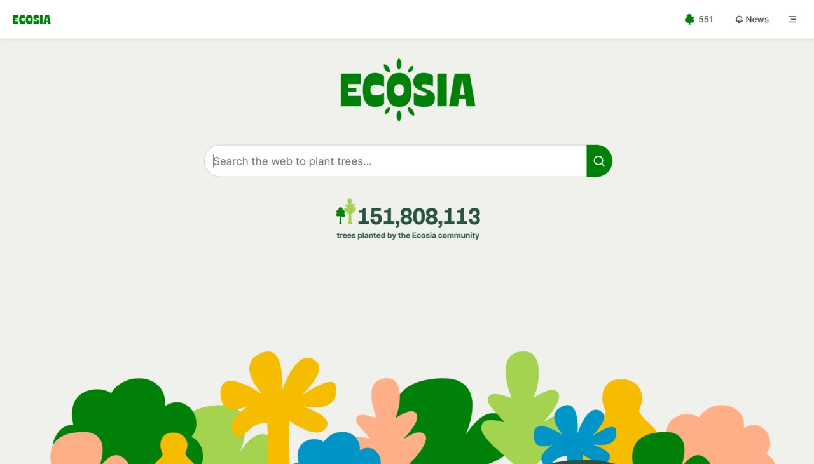

محرك ألماني يستخدم أرباحه لتمويل زراعة الأشجار وينشر تقاريره المالية. يعتمد في أغلب نتائجه على بينج وجوجل، ويبني مع Qwant الفرنسي فهرس أوروبي مستقل ضمن مشروع European Search Perspective. 

**يناسب من يهتم بالأثر البيئي مع نتائج جيدة.**

#### 10. Naver بوابة كوريا الجنوبية

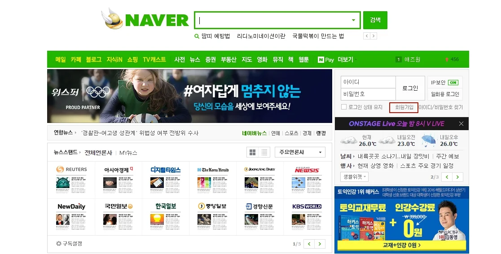

المحرك المهيمن في كوريا الجنوبية، وهو أقرب إلى بوابة محتوى تخلط المدونات والمنتديات والتسوق في صفحة واحدة. يهمّك فقط إذا كنت تستهدف السوق الكوري.

## محركات البحث والذكاء الاصطناعي

دخل الذكاء الاصطناعي عالم البحث من بابين:

داخل محركات البحث نفسها ملخصات جوجل الذكية (AI Overviews)، وCopilot في بينج، والإجابات المولدة في Brave وDuckDuckGo. من خارجها مساعدات توليدية تبحث ثم تلخص، مثل ChatGPT وGemini وPerplexity.

### ماذا يعني هذا لصاحب الموقع في السعودية؟

قد يتحسن ترتيب موقعك وينخفض عدد زياراتك في الوقت نفسه، لأن الملخص أجاب عن السؤال قبل أن يصل الباحث إليك. ولهذا ظهر ما يسمى تحسين الظهور في محركات الذكاء الاصطناعي (GEO)، أن يكون محتواك هو المصدر الذي تبني عليه هذه الأدوات إجاباتها وتذكره. 

ويعتمد ذلك على محتوى واضح البنية، ومعلومات دقيقة ومحدثة، وسمعة قوية لعلامتك على الويب. ولمتابعة هذا الأثر، راقب معدل النقر في Search Console لا الترتيب وحده.

## كيف تستخدم محركات البحث وتستفيد منها بشكل أقوى؟

محرك البحث أكثر من مربع نص. هذه استخدامات يغفل عنها كثيرون:

### البحث العادي بذكاء

استخدم علامات التنصيص للبحث عن عبارة محددة، وعلامة الناقص (-) لاستبعاد كلمة، والأمر site: للبحث داخل موقع واحد. حيل بسيطة تختصر عليك الكثير.

### الخرائط والبحث المحلي

البحث عن "مطعم قريب مني" أو "مغسلة سيارات في الرياض" يعرض لك الخريطة والتقييمات وساعات العمل. ولأصحاب الأنشطة المحلية، هذا هو باب السيو المحلي وملف النشاط التجاري على جوجل.

### الرياضيات والحسابات

اكتب معادلة أو تحويل عملات أو وحدات مباشرة في مربع البحث. وللأسئلة الأعمق، Wolfram Alpha محرك معرفة حسابي يعطيك الإجابة محسوبة بدل الروابط.

### الصحة والطب

مفيد لفهم الأعراض والمصطلحات الطبية، بشرط الاعتماد على مصادر موثوقة مثل وزارة الصحة ومنظمة الصحة العالمية. وتبقى المعلومة الطبية على الإنترنت مكملة لاستشارة الطبيب، لا بديلًا عنها.

### العلوم والبحث العلمي

للطلاب والباحثين محركات البحث العلمي مثل Google Scholar، تعرض الأوراق المحكمة والاستشهادات بدل المقالات العامة. نفصل فيها في قسم الأسئلة الشائعة.

محركات متخصصة في الأوراق البحثية والرسائل العلمية والكتب الأكاديمية، أشهرها Google Scholar، وPubMed للأبحاث الطبية، وSemantic Scholar، وBASE. ومحليًا توفر المكتبة الرقمية السعودية وصولًا لقواعد بيانات أكاديمية لمنسوبي الجامعات.

### القواميس والترجمة

اكتب "معنى" أو "ترجمة" قبل الكلمة، أو استخدم خدمات الترجمة المدمجة في جوجل وبينج وياندكس.

### المكتبات الرقمية

مثل Google Books و[Internet Archive](https://archive.org/)، ومحليا المكتبة الرقمية السعودية التي تتيح مصادر أكاديمية لمنسوبي الجامعات.

### مقاطع الفيديو التعليمية

يوتيوب محرك بحث بحد ذاته، وتبويب "فيديو" في جوجل وبينج يجمع لك الشروحات من منصات مختلفة.

### مواقع الأخبار

تبويب "الأخبار" يرتب النتائج حسب الحداثة، ومفيد لمتابعة حدث من أكثر من مصدر. والقاعدة الذهبية: تحقق من الخبر في مصدرين موثوقين على الأقل.

## كيف تحسن ترتيب موقعك في محركات البحث بسرعة؟

بما أن جوجل يستحوذ على 96% من البحث في السعودية، فأغلب جهدك يبدأ من هناك، ثم من الظهور داخل ملخصاته الذكية. والنتائج "السريعة" الحقيقية تأتي من الأولويات الصحيحة، لا من الحيل:

1. **قم باصلح المشاكل التقنية**: صفحات غير مفهرسة، بطء الموقع، روابط معطلة. هذه غالبا أسرع المكاسب.
2. **حسن الصفحات القريبة من الصفحة الأولى**: الصفحات في المراكز 5–20 تحتاج عادة تحسين بسيط لتقفز.
3. **اهتم بنية البحث**: افهم ما يريده الباحث فعلا، وأجب بوضوح في أول الصفحة.
4. **ابن سمعة وثقة**: محتوى يظهر فيه خبرة حقيقية، وروابط من مواقع محترمة، وملف نشاط تجاري مكتمل.
5. **قس النتائج بشكل صحيح**: الترتيب ومعدل النقر والتحويلات معا، لا الترتيب وحده.

**اي شركة تعدك بالمركز الأول خلال أيام، فابتعد عنها**. السيو الحقيقي يبني نتائج تستمر، وأول التحسن يظهر عادة خلال أسابيع إلى أشهر حسب المنافسة، وحالة الموقع بالنسبة للسوق والمنافسين.

## ماذا نقدم في زيرو تو وان لخدمات السيو SEO؟

في ZERO 2 ONE نقدم خدمات السيو SEO في السعودية بمنهج يجمع بين محركات البحث التقليدية ومحركات الذكاء الاصطناعي:

- **تدقيق سيو شامل**: نكتشف المشاكل التقنية ومشاكل الفهرسة والمحتوى التي تمنع موقعك من الظهور.
- **بحث الكلمات المفتاحية المحلي**: نعرف كيف يبحث العميل السعودي فعلا، بالفصحى وباللهجة.
- **محتوى مبني على السيو المعلوماتي**: مقالات وصفحات تبني سلطة موضوعية لموقعك وتجيب عن أسئلة عملائك.
- **السيو المحلي**: تحسين ملف نشاطك التجاري للظهور في خرائط جوجل في مدينتك.
- **الظهور في نتائج الذكاء الاصطناعي Ai**: هيكلة المحتوى والبيانات المنظمة حتى تذكر علامتك في ملخصات جوجل ومساعدات الذكاء الاصطناعي.

**تقارير شهرية واضحة**: نقيس الترتيب والزيارات والتحويلات، ونشرح لك ما تغير ولماذا.

إذا كنت تبحث عن [افضل شركة تسويق إلكتروني في السعودية](https://zero2one.sa/blog/ar/best-digital-marketing-agency-in-saudi-arabia/) بأرخص باقات سيو في السعودية، تشتغل على ظهورك بمنطق النتائج، تواصل مع ZERO 2 ONE لمراجعة وضع موقعك الحالي واقتراح خطة سيو تناسب نشاطك.

### من المهم معرفة

محركات البحث في السعودية تعني جوجل أولا بفارق كبير، لكن الذكاء الاصطناعي غير طريقة عرض النتائج وطريقة قراءتها. استخدم المحرك المناسب لكل مهمة بالنسبة لك كمستخدم، وإذا كنت صاحب موقع فابني ظهورك على أساسين: سيو قوي في جوجل، ومحتوى تعتمد عليه أدوات الذكاء الاصطناعي في إجاباتها.

## الأسئلة الشائعة عن محركات البحث

### ما هو محرك البحث الأوروبي؟

أوروبا تبني الآن فهرس بحث خاصا بها: Ecosia الألماني وQwant الفرنسي أسسا شركة مشتركة باسم European Search Perspective، هدفها بناء فهرس مستقل عن التقنية الأمريكية يخدم اللغتين الفرنسية والألمانية أولا، وإتاحته للآخرين بما فيهم شركات الذكاء الاصطناعي. 

**هل يعني ذلك أن جوجل في خطر قريب؟** الأرقام تقول لا، لكن التحولات الكبيرة تبدأ عادة من البنية التحتية.

### لماذا جوجل هو أشهر محرك بحث في العالم؟

لأنه يملك أضخم فهرس وأدق نتائج في أغلب اللغات بما فيها العربية، ولأنه المحرك الافتراضي في متصفح كروم ونظام أندرويد وفي أجهزة كثيرة أخرى. 

وتبلغ حصته 91.05% من عمليات البحث في السعودية ([StatCounter fo Saudi](https://gs.statcounter.com/search-engine-market-share/all/saudi-arabia)، أكتوبر 2026)، وأعلنت جوجل أنها تعالج أكثر من 5 تريليونات عملية بحث سنويا.

### ما هي محركات البحث غير جوجل؟

أبرزها بينج من مايكروسوفت، وياهو، وياندكس، وDuckDuckGo، وBrave Search، وStartpage، وEcosia. ولكل منها ميزة: الخصوصية، أو الفهرس المستقل، أو التكامل مع خدمات معينة. وللبحث مع رؤية المصادر هناك Perplexity.

## هل ChatGPT وPerplexity محركات بحث؟

ليست محركات بحث بالمعنى الدقيق، بل مساعدات تبحث ثم تصوغ إجابة. وPerplexity يتميز بعرض مصادره بوضوح، لذلك يفضله الباحثون للتحقق. 

وما زالت الفجوة كبيرة في حجم الزيارات التي ترسلها للمواقع: تشير بيانات متداولة لتتبع الإحالات إلى أن جوجل وحده يرسل أضعاف ما ترسله أدوات الذكاء الاصطناعي مجتمعة.

والخلاصة الأدق: الذكاء الاصطناعي لم "يقتل" البحث، لكنه غير سلوك القراءة. المستخدم يقرأ الإجابة داخل الملخص وقد لا ينقر، لكنه ما زال يبدأ من محرك البحث.

### ما هو محرك البحث غير المراقب؟

المقصود به محرك بحث لا يتتبع مستخدميه: لا يحفظ سجل البحث، ولا يربط عملياتك بعنوان IP، ولا يبني ملف إعلاني عنك. من أشهرها DuckDuckGo وStartpage وBrave Search وSwisscows. 

ومهم التنبيه إلى أن "غير مراقب" تعني حماية الخصوصية، ولا تعني أن المحرك يعرض محتوى محظورًا أو أن استخدامه يعفيك من الأنظمة المحلية.

### هل يمكن الاعتماد على ChatGPT بدل جوجل؟

يصلح للشرح والتلخيص وإنجاز المهام، لكنه ليس بديل كامل. للتحقق من رقم أو خبر حديث، ارجع إلى محرك بحث تقليدي أو إلى أداة تعرض مصادرها.

### هل تؤثر ملخصات الذكاء الاصطناعي على زيارات موقعي؟

قد تقلل معدل النقر في الأسئلة المعلوماتية حتى لو بقي ترتيبك ثابت، لكنها في المقابل فرصة لظهور علامتك كمصدر موثوق. والحل أن تقيس النقرات والتحويلات لا الترتيب فقط، وأن تبني محتوى يصلح لأن يستشهد به.

**المصادر**:

- [Ecosia](https://blog.ecosia.org/eusp/): مشروع الفهرس الأوروبي European Search Perspective.
- [CNET](https://www.cnet.com/tech/services-and-software/google-search-alternatives/): Google Search Isn’t Your Only Option
- [Search Engine Journal](https://www.searchenginejournal.com/alternative-search-engines/271409/): 25 Alternative Search Engines
